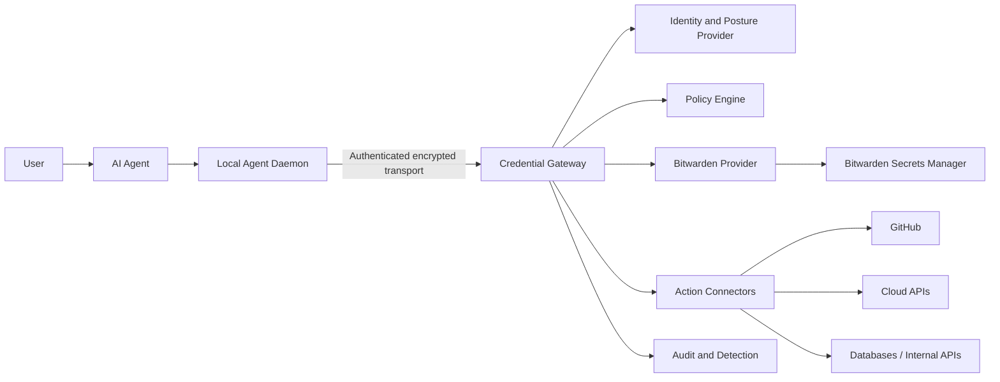
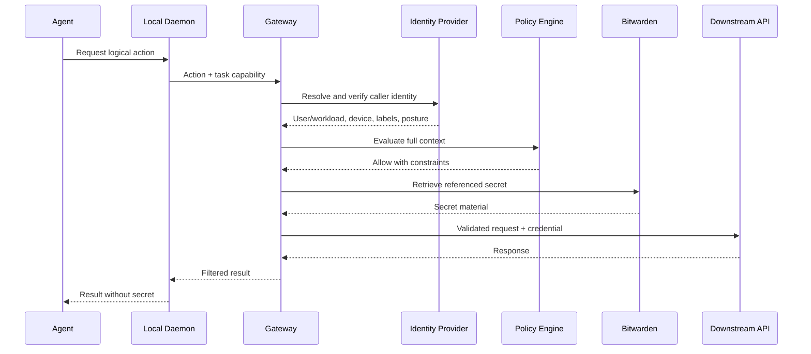

# Agent Credential Firewall — System Design

Status: Draft

Last updated: 2026-10-24

## 1. Overview

Agent Credential Firewall (ACF) is an identity-aware, task-scoped credential gateway for AI agents.

Its central security property is:

> An agent should be able to perform an authorized action without receiving a reusable long-lived credential whenever possible.

ACF sits between agents and credential-backed services. It authenticates the calling user, device, workload, and task; evaluates policy; obtains the required secret from Bitwarden Secrets Manager; and either performs the requested action or grants a tightly constrained, short-lived lease.

The initial deployment model assumes:

- Agents run on developer endpoints, trusted servers, VPS instances, and remote terminals.
- Devices communicate with gateways over a mutually authenticated, encrypted transport.
- Secrets are stored in Bitwarden Secrets Manager.
- Bitwarden Secrets Manager SDK is used by gateways to retrieve secrets.
- The gateway is deployed on dedicated, hardened infrastructure separate from agent workloads.

## 2. Problem statement

AI agents commonly consume bearer tokens through environment variables, configuration files, CI secrets, or shell sessions. This creates several problems:

- A copied bearer token can be replayed from another machine.
- Long-lived tokens survive beyond the task that required them.
- One shared token cannot identify the device, agent, or task that used it.
- Secrets can leak through logs, traces, shell history, child processes, crash dumps, or debugging tools.
- Prompt injection may persuade an agent to reveal a secret or use it against an attacker-controlled destination.
- Credentials are duplicated across laptops, VPS instances, build systems, and temporary terminals.
- Revocation and rotation become difficult because consumers are not centrally inventoried.
- Network identity alone cannot prove that an already authorized endpoint is not compromised.

Moving these tokens into a secrets manager improves storage, but does not solve the runtime exposure problem if agents can still retrieve raw values freely.

## 3. Goals

ACF should:

1. Keep Bitwarden access tokens away from agent hosts.
2. Prefer proxying authorized actions over returning secret values.
3. Bind authorization to user, device, workload, agent, task, resource, action, and time.
4. Support developer endpoints, unattended VPS workloads, and remote terminals.
5. Support pluggable connection identity, device identity, and posture providers.
6. Enforce least privilege across development and production environments.
7. Produce useful audit records without recording secret values.
8. Support rapid session revocation and device isolation.
9. Remain usable with multiple secret providers through a provider interface.
10. Fail closed when identity, policy, or secret retrieval cannot be verified.

## 4. Non-goals

The first version will not:

- Replace Bitwarden Secrets Manager.
- Replace an organization's identity provider or network access control system.
- Guarantee safety after a gateway host is fully compromised.
- Turn static third-party bearer tokens into cryptographically non-exportable credentials.
- Provide a general-purpose remote shell.
- Permit arbitrary secret retrieval from untrusted remote terminals.
- Automatically rotate every downstream credential type.
- Treat network membership or reachability alone as sufficient authorization.

## 5. Threat model

### 5.1 Assets

- Bitwarden machine-account access tokens.
- Downstream API tokens, database credentials, certificates, and signing keys.
- Authorization policy and task capability definitions.
- Audit records and identity mappings.
- Gateway runtime memory.

### 5.2 Potential attackers

- Malicious content encountered by an agent, including prompt injection.
- A compromised developer endpoint.
- A compromised VPS or CI worker.
- A malicious or vulnerable agent tool or plugin.
- An authenticated node with valid connectivity but excessive permissions.
- An attacker with access to logs, traces, crash dumps, or backups.
- A malicious insider attempting to use legitimate infrastructure outside an approved task.

### 5.3 Trust assumptions

- Bitwarden and configured identity providers behave according to their documented security models.
- Gateway hosts are more trusted and more tightly controlled than agent hosts.
- Connection and device identity do not prove that an endpoint is uncompromised.
- Downstream APIs correctly enforce the credentials and requests presented to them.
- Host-level root compromise can expose credentials currently in gateway memory.

## 6. Architecture



### 6.1 Trust boundaries

```text
Less trusted                         More trusted

User content / repositories
        ↓
AI agent process
        ↓
Local agent daemon
        ↓  authenticated encrypted connection
Credential gateway
        ↓
Bitwarden and approved downstream services
```

Agents and the content they process are treated as potentially hostile. The gateway is a high-value security boundary and must not execute agent-provided code.

## 7. Core components

### 7.1 Local Agent Daemon

The daemon provides a small local API to the agent and attaches trusted local context that the model cannot freely choose.

Responsibilities:

- Establish a mutually authenticated, encrypted connection to the gateway.
- Identify the local agent runtime and current task.
- Prevent agents from forging device or process metadata.
- Keep short-lived task capabilities in protected local storage or memory.
- Remove credentials from logs and error reports.
- Optionally supervise processes receiving temporary credential leases.

The daemon is not trusted with a Bitwarden machine-account token.

### 7.2 Credential Gateway

The gateway is the main enforcement point.

Responsibilities:

- Resolve trusted caller, device, and workload identity from configured providers.
- Validate task capabilities and request freshness.
- Evaluate authorization policy.
- Retrieve secrets through the configured provider.
- Execute approved downstream actions or issue constrained leases.
- Enforce destination, method, resource, and response filtering.
- Emit tamper-evident audit events.
- Apply rate limits and anomaly controls.

The gateway must never expose a general-purpose `get any secret` endpoint to agents.

### 7.3 Identity Context Provider

The gateway should obtain identity and posture data through a provider interface rather than depend on a specific network or identity vendor:

```go
type IdentityContextProvider interface {
    Resolve(ctx context.Context, connection ConnectionInfo) (IdentityContext, error)
    Verify(ctx context.Context, identity IdentityContext) error
}
```

Provider output must be derived from authenticated connection state or signed assertions. Identity headers supplied directly by an agent are untrusted unless a trusted intermediary removes and replaces them.

Possible implementations include mutual TLS, workload identity, signed device certificates, private-network identity, or an organization's existing identity-aware proxy.

### 7.4 Policy Engine

Authorization decisions should consider:

- User or workload identity.
- Device identity and labels.
- Device posture, when available.
- Agent identity and version.
- Task identifier and task issuer.
- Requested action and resource.
- Environment and region.
- Time window and lease TTL.
- Human approval state.
- Current risk signals.

Example decision input:

```json
{
  "subject": {
    "user": "alice@example.com",
    "device": "vps-agent-17",
    "labels": ["agent", "production"],
    "agent": "acf-agent-123"
  },
  "task": {
    "id": "fix-issue-892",
    "issuer": "orchestrator-prod",
    "expiresAt": "2026-10-24T15:30:00Z"
  },
  "request": {
    "action": "github.create_pull_request",
    "resource": "repo:example/backend"
  }
}
```

### 7.5 Secret Provider Interface

The gateway should isolate secret-manager-specific behavior behind an interface:

```go
type SecretProvider interface {
    Get(ctx context.Context, ref SecretRef) (SecretMaterial, error)
    ListMetadata(ctx context.Context, scope Scope) ([]SecretMetadata, error)
}
```

The initial implementation uses Bitwarden Secrets Manager SDK. Future providers could include HashiCorp Vault, cloud secret managers, or a local development provider.

Secret values must be represented by types that discourage logging, serialization, and accidental string formatting.

### 7.6 Action Connectors

Action connectors use credentials without revealing them to the agent. The gateway core must not contain one hard-coded implementation for every token-using service. Connector support is divided into three layers.

#### 7.6.1 Declarative HTTP provider profiles

Most REST APIs that use bearer tokens, API-key headers, or basic authentication should be supported by a generic HTTP connector runtime and an administrator-reviewed provider profile.

A provider profile defines:

- A fixed base URL and allowed ports.
- Named semantic actions.
- HTTP method and path templates for each action.
- Parameter and body schemas.
- Authentication strategy and credential slot.
- Redirect behavior.
- Request and response header filters.
- Response-field filters.
- Whether an action is read-only, mutating, or approval-gated.

Provider profiles contain no secret values. Resource registrations bind credential slots to logical `SecretRef` values.

#### 7.6.2 Reusable authentication strategies

The connector runtime should provide a small set of reusable authentication modules:

```rust
enum AuthenticationStrategy {
    BearerToken,
    HeaderApiKey { header: HeaderName },
    BasicAuth,
    OAuth2ClientCredentials,
    OAuth2RefreshToken,
    AwsSigV4,
}
```

Not every strategy must be implemented in the first release. The abstraction prevents authentication behavior from being duplicated across provider profiles.

#### 7.6.3 Native connectors

A dedicated Rust connector is appropriate when a service requires:

- A non-HTTP protocol such as a database or SSH protocol.
- Complex request signing or key handling.
- Multi-step transactions, rollback, or conflict detection.
- Complex OAuth or installation-token exchange.
- Provider-specific response filtering or safety invariants.
- Semantics that cannot be expressed safely by the declarative profile.

Initial native connectors may include database execution, SSH certificate use, GitHub App authentication, and Kubernetes API integration.

Native and declarative connectors implement the same interface:

```rust
pub trait ActionConnector {
    fn descriptor(&self) -> ConnectorDescriptor;

    async fn execute(
        &self,
        context: &AuthorizedContext,
        request: ActionRequest,
        credentials: CredentialSet,
    ) -> Result<ActionResponse, ConnectorError>;
}
```

#### 7.6.4 Connector security boundary

Agents select only a logical action, resource, and validated parameters. Agents must not select:

- A secret reference.
- An authentication strategy.
- A credential-injection destination.
- An arbitrary absolute URL.
- An `Authorization` or API-key header.
- Redirect behavior.

The gateway resolves these values from trusted provider and resource configuration. A generic unrestricted HTTP proxy would create a secret-exfiltration and server-side request forgery primitive and is therefore forbidden.

OpenAPI documents may be used to generate an initial provider profile, but generated profiles are untrusted input until an administrator reviews their hosts, endpoints, schemas, credential placement, response filtering, and approval requirements.

### 7.7 Example: Cloudflare DNS

This example shows the complete lifecycle for an agent that needs to inspect and create DNS records without receiving a Cloudflare API token.

#### 7.7.1 Credential provisioning

The administrator creates two Cloudflare API tokens scoped to one specific zone:

```text
acf-example-com-dns-read
  Permission: Zone / DNS Read
  Resource:   Specific zone / example.com

acf-example-com-dns-write
  Permission: Zone / DNS Write
  Resource:   Specific zone / example.com
```

Read and write credentials are separated so read-only requests do not expose a write-capable token inside the gateway process. The tokens are stored in Bitwarden, for example:

```text
Project: acf-cloudflare-production

cloudflare/example.com/dns-read
cloudflare/example.com/dns-write
```

Only the appropriate gateway machine account can read this project. The agent has no direct Bitwarden access.

Cloudflare documents `DNS Read` and `DNS Write` as zone permissions and recommends scoped API tokens instead of the legacy global API key. See the [Cloudflare API token permissions](https://developers.cloudflare.com/fundamentals/api/reference/permissions/).

#### 7.7.2 Declarative provider profile

Cloudflare DNS can initially use the generic HTTP connector:

```yaml
provider: cloudflare
version: 1

base_url: https://api.cloudflare.com/client/v4

authentication:
  bearer:
    type: bearer

actions:
  cloudflare.dns.records.list:
    method: GET
    path: /zones/{zone_id}/dns_records
    credential_slot: read
    classification: read
    query_schema:
      name: { type: dns_name, required: false }
      type: { enum: [A, AAAA, CNAME, TXT, MX] }

  cloudflare.dns.records.create:
    method: POST
    path: /zones/{zone_id}/dns_records
    credential_slot: write
    classification: mutate
    approval: required
    body_schema:
      type: object
      required: [type, name, content]
      properties:
        type: { enum: [A, AAAA, CNAME, TXT] }
        name: { type: dns_name }
        content: { type: string }
        ttl: { type: integer, minimum: 60, maximum: 86400 }
        proxied: { type: boolean }
```

The list and create actions map to Cloudflare's documented `GET /zones/{zone_id}/dns_records` and `POST /zones/{zone_id}/dns_records` endpoints. See the [Cloudflare DNS Records API](https://developers.cloudflare.com/api/resources/dns/subresources/records/).

#### 7.7.3 Resource registration

The administrator registers the actual zone and binds credential slots to logical Bitwarden references:

```yaml
resources:
  cloudflare-zone:example.com:
    provider: cloudflare
    bindings:
      zone_id: 023e105f4ecef8ad9ca31a8372d0c353

    credentials:
      read:
        secret_ref: bitwarden://cloudflare/example.com/dns-read
      write:
        secret_ref: bitwarden://cloudflare/example.com/dns-write

    constraints:
      allowed_record_types: [A, AAAA, CNAME, TXT]
      allowed_names: ["*.example.com"]
      denied_names: ["example.com", "mail.example.com"]
      allow_wildcard_records: false
      allow_delete: false
      min_ttl: 60
      max_ttl: 86400
      max_changes_per_task: 5
```

The URI beginning with `bitwarden://` is an ACF logical reference, not a secret value and not necessarily a native Bitwarden URI format.

#### 7.7.4 Query interaction

The user asks the agent to inspect `api.example.com`. The orchestrator grants a short-lived task capability containing:

```json
{
  "taskId": "dns-change-892",
  "actions": ["cloudflare.dns.records.list"],
  "resources": ["cloudflare-zone:example.com"],
  "constraints": {
    "names": ["api.example.com"],
    "recordTypes": ["A"]
  },
  "expiresAt": "2026-10-24T18:15:00Z",
  "jti": "capability-01JB..."
}
```

The agent submits a semantic request:

```json
{
  "requestId": "req-001",
  "taskId": "dns-change-892",
  "action": "cloudflare.dns.records.list",
  "resource": "cloudflare-zone:example.com",
  "parameters": {
    "name": "api.example.com",
    "type": "A"
  }
}
```

The gateway:

1. Verifies connection identity and the task capability.
2. Confirms that the action, zone, name, and record type are allowed.
3. Resolves the resource's `read` credential slot.
4. Retrieves the read token from Bitwarden.
5. Injects the bearer token into the fixed Cloudflare request.
6. Filters the provider response.
7. Returns DNS data without returning the token.
8. Emits a redacted audit event.

#### 7.7.5 Mutating interaction and approval

To create a record, the agent submits:

```json
{
  "requestId": "req-002",
  "taskId": "dns-change-892",
  "action": "cloudflare.dns.records.create",
  "resource": "cloudflare-zone:example.com",
  "parameters": {
    "type": "A",
    "name": "api.example.com",
    "content": "203.0.113.10",
    "ttl": 300,
    "proxied": true
  }
}
```

Before retrieving the write credential, the gateway validates the task capability, record name, zone suffix, record type, content, TTL, mutation count, and applicable policy. It may also issue a read request to detect conflicts.

Because the action is approval-gated, the gateway returns an exact proposed change:

```json
{
  "status": "approval_required",
  "approvalId": "approval-123",
  "change": {
    "zone": "example.com",
    "operation": "create",
    "record": {
      "type": "A",
      "name": "api.example.com",
      "content": "203.0.113.10",
      "ttl": 300,
      "proxied": true
    }
  },
  "expiresAt": "2026-10-24T18:10:00Z"
}
```

Approval must bind the approver, request hash, action, resource, exact parameters, and expiration time. The agent cannot approve its own request. Any parameter change invalidates the approval.

After approval, the gateway revalidates the complete request, resolves the `write` credential slot, retrieves the write token, calls Cloudflare, filters the result, and records the outcome. Replay protection prevents the approved mutation from being submitted twice.

#### 7.7.6 Audit and rotation

The audit event records identity, task, action, logical resource, approval, logical secret reference, requested DNS change, provider result, and timestamps. It never records the bearer token, authorization header, Bitwarden access token, or private keys.

Token rotation is an administrative workflow:

1. Create a new scoped Cloudflare token.
2. Verify that the token is active through Cloudflare's token verification endpoint.
3. Update the corresponding Bitwarden secret.
4. Validate gateway use of the new token.
5. Revoke the old Cloudflare token.

For higher assurance, read and write credentials may be placed in separate Bitwarden projects and consumed by separate gateway security domains. This limits a compromised read path from becoming a DNS mutation path.

This example illustrates the general ACF model: every service and resource is explicitly registered, but ordinary token-based REST services are added through reviewed profiles and configuration rather than one-off gateway code.

- Generic HTTP bearer-token proxy with strict host, path, and method allowlists.
- GitHub operations scoped to approved organizations and repositories.
- Database query or migration execution with statement controls.
- Cloud API operations scoped to approved accounts and resources.

Connectors must parse and validate requests instead of accepting arbitrary command lines.

## 8. Authorization model

ACF uses layered authorization:

1. **Network layer** — private routing and firewall rules control which nodes can reach a gateway.
2. **Connection identity** — the gateway authenticates the calling user, device, or workload through a configured identity mechanism.
3. **Device and workload assertions** — signed claims provide labels, posture, environment, and other trusted context.
4. **Task capability** — the orchestrator grants a short-lived set of actions and resources to one task.
5. **Gateway policy** — contextual policy produces the final allow or deny decision.
6. **Connector enforcement** — the connector validates the exact downstream request.

No single layer is sufficient by itself.

### 8.1 Example trusted identity context

```json
{
  "principal": "workload:agent-prod-17",
  "deviceId": "device-01JB...",
  "labels": ["agent", "production", "eu"],
  "posture": {
    "managed": true,
    "diskEncrypted": true,
    "lastVerifiedAt": "2026-10-24T15:00:00Z"
  },
  "issuer": "identity-provider",
  "expiresAt": "2026-10-24T15:15:00Z"
}
```

### 8.2 Task capability

A task capability is short-lived, audience-bound, and signed by an approved orchestrator. It should contain:

- Issuer and audience.
- Agent and task identifiers.
- Permitted actions and resources.
- Issued-at, not-before, and expiration timestamps.
- Unique identifier for revocation and replay detection.
- Optional human approval reference.

Task capabilities authorize requests to ACF; they must never contain downstream secrets.

## 9. Credential usage modes

### 9.1 Proxy Mode — preferred

The gateway obtains the secret and performs the downstream request. The agent receives only a filtered business response.

Advantages:

- The downstream credential never reaches the agent host.
- Destination and operation restrictions can be enforced centrally.
- Prompt injection cannot directly print or exfiltrate the credential.
- Usage is attributable to a device, agent, and task.

### 9.2 Local Lease Mode — compatibility fallback

Some tools require a raw credential. In this mode, ACF may return a short-lived lease when the downstream service supports short-lived credentials, or provide a secret to a supervised process as a last resort.

Required controls:

- Minimal TTL.
- Single task and device binding at the ACF layer.
- No disk persistence.
- Log and trace redaction.
- Explicit policy permission.
- Optional human approval.
- Cleanup when the supervised process exits.

A static bearer token cannot be made truly device-bound after disclosure. Local Lease Mode therefore carries higher residual risk.

## 10. Request flow



Requests must include a nonce or request identifier. The gateway should reject expired capabilities, replayed identifiers, unexpected destinations, and policy/identity mismatches.

## 11. Deployment model

### 11.1 Recommended topology

```text
Private network / authenticated service fabric
├── gateway-dev-01        role=gateway, env=dev
├── gateway-prod-eu-01    role=gateway, env=prod, region=eu
├── gateway-prod-eu-02    role=gateway, env=prod, region=eu
├── laptop-agents         user and device identities
├── vps-agent-dev         role=agent, env=dev
└── vps-agent-prod        role=agent, env=prod
```

Gateways should:

- Run on dedicated, hardened hosts.
- Be separate from hosts executing agents or user-provided code.
- Have no public inbound listener.
- Listen only on a private interface or authenticated service endpoint.
- Permit outbound access only to Bitwarden, audit infrastructure, and approved downstream services.
- Use separate Bitwarden machine accounts or access tokens per gateway instance and environment.
- Keep secret values in memory for the shortest practical duration.
- Be deployed redundantly for production availability.

At minimum, development and production must use separate gateways and Bitwarden machine accounts.

### 11.2 Endpoint classes

#### Developer endpoints

- Use user and device identity together.
- Require posture checks for sensitive environments.
- Require confirmation for high-impact production actions.
- Default to development resources.

#### Unattended VPS agents

- Use tagged workload/device identity instead of personal identity.
- Give each VPS or workload a unique agent identity.
- Restrict actions and resources per workload.
- Avoid storing Bitwarden access tokens on the VPS.

#### Remote or unmanaged terminals

- Never return raw production secrets.
- Allow only proxy actions or remote execution on trusted infrastructure.
- Use very short task capabilities and approval for sensitive operations.

## 12. Bitwarden integration

Each gateway authenticates as a narrowly scoped Bitwarden machine account. Projects should align with security boundaries such as environment, region, or service.

Example:

```text
acf-dev              → project: agent-dev
acf-prod-eu-01       → project: agent-prod-eu
acf-prod-eu-02       → project: agent-prod-eu
```

Gateway access tokens are bootstrap credentials and must be protected separately from agent workloads. Preferred storage options include TPM- or KMS-protected service credentials and operating-system credential facilities. They must not be committed to source control, built into images, or passed in process arguments.

Because an authenticated Bitwarden session may remain usable for a period after access-token revocation, gateway session termination and network isolation must be separate incident-response controls.

## 13. Audit and detection

Every decision should emit a structured event containing:

- Request and task identifiers.
- User, device, agent, and gateway identities.
- Requested and resolved action/resource.
- Policy decision and matched policy version.
- Connector and secret reference identifiers.
- Downstream status and latency.
- Approval reference, when applicable.
- Risk signals and denial reason.

Audit events must not contain:

- Secret values.
- Authorization headers.
- Raw request bodies that may contain credentials.
- Unfiltered downstream responses.

Useful detections include unusual request volume, new resource access, off-hours production use, repeated denials, task-capability replay, and a device accessing multiple unrelated security domains.

## 14. Failure behavior

ACF should fail closed when:

- Connection identity cannot be resolved or verified.
- Required device or workload assertions cannot be verified.
- The task capability is absent, invalid, expired, or revoked.
- Policy is unavailable or ambiguous.
- The destination does not match the connector allowlist.
- Secret retrieval returns an unexpected project or identifier.
- Audit emission required by policy cannot be completed.

Short, bounded caching may be supported for availability, but offline access to production secrets should be disabled by default.

## 15. Incident response

When a device or gateway is suspected of compromise:

1. Remove or quarantine the device through the configured network and identity controls.
2. Revoke active ACF task capabilities and sessions.
3. Stop the affected gateway instance when applicable.
4. Revoke its Bitwarden access token.
5. Identify downstream credentials used during the exposure window.
6. Rotate affected credentials.
7. Correlate ACF audit events with Bitwarden and downstream service logs.
8. Restore the node from a trusted image before re-enrollment.

## 16. Initial API sketch

The external API is action-oriented:

```http
POST /v1/actions/github/create-pull-request
POST /v1/actions/http/request
POST /v1/actions/database/query
POST /v1/sessions/revoke
GET  /v1/tasks/{task_id}/capabilities
```

The first version should not expose this endpoint:

```http
GET /v1/secrets/{secret_id}/value
```

Example action request:

```json
{
  "taskId": "fix-issue-892",
  "requestId": "01JB...",
  "action": "github.create_pull_request",
  "resource": "repo:example/backend",
  "parameters": {
    "head": "agent/fix-892",
    "base": "main",
    "title": "Fix authorization check"
  }
}
```

## 17. Implementation technology

### 17.1 Decision

The security-sensitive data plane will be implemented in Rust. This includes:

- Credential Gateway.
- Local Agent Daemon.
- Bitwarden Secrets Manager adapter.
- Identity and policy enforcement interfaces.
- Action connectors.
- Task-capability validation and audit event generation.

The management control plane and web interface are not required to use Rust. They may use the technologies most appropriate for their product and operational requirements, provided they communicate with the data plane through authenticated, versioned interfaces.

### 17.2 Rationale

Rust is selected because it:

- Can consume the native Rust Bitwarden Secrets Manager SDK without an additional language binding or FFI boundary.
- Provides memory and type safety appropriate for a long-running, high-privilege gateway.
- Produces self-contained binaries suitable for endpoints and VPS deployments.
- Supports a shared protocol and security-type implementation across the gateway and local daemon.
- Has mature asynchronous networking and TLS libraries.
- Allows secret-bearing types to restrict accidental formatting, cloning, serialization, and logging.

Rust memory safety does not by itself prevent secret exposure. Logs, traces, crash dumps, child processes, connector behavior, and downstream requests remain part of the security boundary.

### 17.3 Initial stack

The initial implementation should prefer:

| Concern | Technology |
| --- | --- |
| Async runtime | Tokio |
| HTTP server | Axum |
| HTTP client | Reqwest with rustls |
| TLS and mTLS | rustls |
| Serialization | Serde |
| CLI | Clap |
| Secret-bearing values | `secrecy` and `zeroize` |
| Structured telemetry | `tracing` |
| Bitwarden integration | Native Rust Secrets Manager SDK |

The first protocol should use HTTP/2 with JSON over TLS rather than a custom transport. gRPC may be added later if measurements demonstrate a need.

### 17.4 Workspace structure

The repository should use a Cargo workspace with explicit security boundaries:

```text
crates/
├── acf-gateway/          # Gateway service and request lifecycle
├── acf-agent/            # Endpoint and VPS daemon
├── acf-protocol/         # API models and task capabilities
├── acf-identity/         # Pluggable connection identity providers
├── acf-policy/           # Authorization decisions
├── acf-secrets/          # SecretProvider traits and protected types
├── acf-bitwarden/        # Bitwarden SDK adapter
├── acf-connectors/       # Downstream action connectors
└── acf-audit/            # Structured audit events
```

Shared crates must preserve dependency direction: provider and connector implementations may depend on core interfaces, but core policy and protocol crates must not depend on a particular provider.

### 17.5 Secret-handling requirements

Rust code that handles secret material must:

- Use dedicated secret-bearing types instead of ordinary `String` values where practical.
- Avoid implementing or deriving `Debug`, `Display`, `Serialize`, or `Clone` for plaintext secret types.
- Redact secret fields from errors, traces, metrics, and audit events.
- Minimize plaintext lifetime and the number of memory copies.
- Zeroize owned plaintext buffers when their lifecycle ends where the implementation can do so reliably.
- Avoid passing secrets in command-line arguments or persisting them to disk.
- Document unavoidable plaintext boundaries, including TLS libraries and downstream SDKs.

## 18. MVP scope

### Phase 1 — foundation

- Gateway service reachable only through a private, authenticated interface.
- Pluggable caller and device identity resolution.
- Bitwarden Secrets Manager provider.
- Static policy configuration with deny-by-default behavior.
- Generic HTTP bearer-token connector with strict allowlists.
- Structured audit events with secret redaction tests.

### Phase 2 — agent-aware authorization

- Signed task capabilities.
- Local agent daemon.
- GitHub action connector.
- Session and capability revocation.
- Approval workflow for sensitive actions.

### Phase 3 — production hardening

- High-availability gateways per environment/region.
- Posture-aware policy.
- Anomaly detection and SIEM integration.
- Credential inventory and risk scoring.
- Automated incident-response workflows.
- Additional secret providers and action connectors.

## 19. Open questions

- Should policy use OPA/Rego, Cedar, or a smaller purpose-built model?
- How should an orchestrator prove task provenance?
- Which operations require human approval by default?
- How should connectors filter potentially sensitive downstream responses?
- Which secret types can be replaced by genuinely short-lived credentials?
- How should gateway bootstrap credentials be provisioned in self-hosted deployments?
- What is the acceptable behavior during Bitwarden or identity-provider outages?
- Should tenants receive dedicated gateway instances or isolated logical partitions?

## 20. Security principles

1. Prefer actions over secrets.
2. Treat every agent as potentially influenced by hostile input.
3. Authenticate the connection; authorize the task and operation.
4. Separate environments and failure domains.
5. Minimize plaintext lifetime and copies.
6. Make every credential use attributable.
7. Do not rely on network location as authorization.
8. Design revocation and rotation before adding more connectors.
