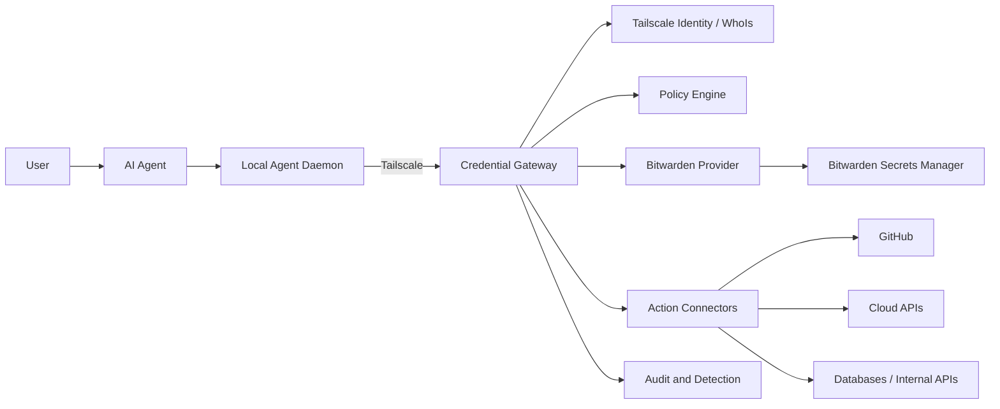
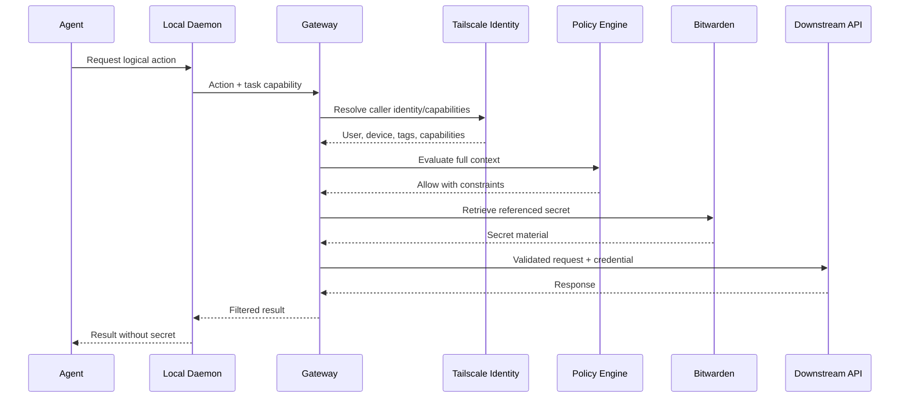

# Agent Credential Firewall — System Design

Status: Draft

Last updated: 2026-10-24

## 1. Overview

Agent Credential Firewall (ACF) is an identity-aware, task-scoped credential gateway for AI agents.

Its central security property is:

> An agent should be able to perform an authorized action without receiving a reusable long-lived credential whenever possible.

ACF sits between agents and credential-backed services. It authenticates the calling user, device, workload, and task; evaluates policy; obtains the required secret from Bitwarden Secrets Manager; and either performs the requested action or grants a tightly constrained, short-lived lease.

The initial deployment model assumes:

- Agents run on developer endpoints, trusted servers, VPS instances, and remote terminals.
- Devices communicate over a Tailscale tailnet.
- Secrets are stored in Bitwarden Secrets Manager.
- Bitwarden Secrets Manager SDK is used by gateways to retrieve secrets.
- The gateway is deployed on dedicated, hardened infrastructure separate from agent workloads.

## 2. Problem statement

AI agents commonly consume bearer tokens through environment variables, configuration files, CI secrets, or shell sessions. This creates several problems:

- A copied bearer token can be replayed from another machine.
- Long-lived tokens survive beyond the task that required them.
- One shared token cannot identify the device, agent, or task that used it.
- Secrets can leak through logs, traces, shell history, child processes, crash dumps, or debugging tools.
- Prompt injection may persuade an agent to reveal a secret or use it against an attacker-controlled destination.
- Credentials are duplicated across laptops, VPS instances, build systems, and temporary terminals.
- Revocation and rotation become difficult because consumers are not centrally inventoried.
- Network identity alone cannot prove that an already authorized endpoint is not compromised.

Moving these tokens into a secrets manager improves storage, but does not solve the runtime exposure problem if agents can still retrieve raw values freely.

## 3. Goals

ACF should:

1. Keep Bitwarden access tokens away from agent hosts.
2. Prefer proxying authorized actions over returning secret values.
3. Bind authorization to user, device, workload, agent, task, resource, action, and time.
4. Support developer endpoints, unattended VPS workloads, and remote terminals.
5. Use Tailscale identity and application capabilities where available.
6. Enforce least privilege across development and production environments.
7. Produce useful audit records without recording secret values.
8. Support rapid session revocation and device isolation.
9. Remain usable with multiple secret providers through a provider interface.
10. Fail closed when identity, policy, or secret retrieval cannot be verified.

## 4. Non-goals

The first version will not:

- Replace Bitwarden Secrets Manager.
- Replace Tailscale access control.
- Guarantee safety after a gateway host is fully compromised.
- Turn static third-party bearer tokens into cryptographically non-exportable credentials.
- Provide a general-purpose remote shell.
- Permit arbitrary secret retrieval from untrusted remote terminals.
- Automatically rotate every downstream credential type.
- Treat tailnet membership alone as sufficient authorization.

## 5. Threat model

### 5.1 Assets

- Bitwarden machine-account access tokens.
- Downstream API tokens, database credentials, certificates, and signing keys.
- Authorization policy and task capability definitions.
- Audit records and identity mappings.
- Gateway runtime memory.

### 5.2 Potential attackers

- Malicious content encountered by an agent, including prompt injection.
- A compromised developer endpoint.
- A compromised VPS or CI worker.
- A malicious or vulnerable agent tool or plugin.
- A tailnet node with valid connectivity but excessive permissions.
- An attacker with access to logs, traces, crash dumps, or backups.
- A malicious insider attempting to use legitimate infrastructure outside an approved task.

### 5.3 Trust assumptions

- Bitwarden and Tailscale behave according to their documented security models.
- Gateway hosts are more trusted and more tightly controlled than agent hosts.
- Tailscale provides authenticated network identity, but not proof that an endpoint is uncompromised.
- Downstream APIs correctly enforce the credentials and requests presented to them.
- Host-level root compromise can expose credentials currently in gateway memory.

## 6. Architecture



### 6.1 Trust boundaries

```text
Less trusted                         More trusted

User content / repositories
        ↓
AI agent process
        ↓
Local agent daemon
        ↓  authenticated tailnet connection
Credential gateway
        ↓
Bitwarden and approved downstream services
```

Agents and the content they process are treated as potentially hostile. The gateway is a high-value security boundary and must not execute agent-provided code.

## 7. Core components

### 7.1 Local Agent Daemon

The daemon provides a small local API to the agent and attaches trusted local context that the model cannot freely choose.

Responsibilities:

- Establish a mutually authenticated connection to the gateway over Tailscale.
- Identify the local agent runtime and current task.
- Prevent agents from forging device or process metadata.
- Keep short-lived task capabilities in protected local storage or memory.
- Remove credentials from logs and error reports.
- Optionally supervise processes receiving temporary credential leases.

The daemon is not trusted with a Bitwarden machine-account token.

### 7.2 Credential Gateway

The gateway is the main enforcement point.

Responsibilities:

- Resolve the caller's Tailscale identity and application capabilities.
- Validate task capabilities and request freshness.
- Evaluate authorization policy.
- Retrieve secrets through the configured provider.
- Execute approved downstream actions or issue constrained leases.
- Enforce destination, method, resource, and response filtering.
- Emit tamper-evident audit events.
- Apply rate limits and anomaly controls.

The gateway must never expose a general-purpose `get any secret` endpoint to agents.

### 7.3 Policy Engine

Authorization decisions should consider:

- Tailnet user identity.
- Device identity and tags.
- Device posture, when available.
- Agent identity and version.
- Task identifier and task issuer.
- Requested action and resource.
- Environment and region.
- Time window and lease TTL.
- Human approval state.
- Current risk signals.

Example decision input:

```json
{
  "subject": {
    "user": "alice@example.com",
    "device": "vps-agent-17",
    "tags": ["tag:agent-prod"],
    "agent": "acf-agent-123"
  },
  "task": {
    "id": "fix-issue-892",
    "issuer": "orchestrator-prod",
    "expiresAt": "2026-10-24T15:30:00Z"
  },
  "request": {
    "action": "github.create_pull_request",
    "resource": "repo:example/backend"
  }
}
```

### 7.4 Secret Provider Interface

The gateway should isolate secret-manager-specific behavior behind an interface:

```go
type SecretProvider interface {
    Get(ctx context.Context, ref SecretRef) (SecretMaterial, error)
    ListMetadata(ctx context.Context, scope Scope) ([]SecretMetadata, error)
}
```

The initial implementation uses Bitwarden Secrets Manager SDK. Future providers could include HashiCorp Vault, cloud secret managers, or a local development provider.

Secret values must be represented by types that discourage logging, serialization, and accidental string formatting.

### 7.5 Action Connectors

Action connectors use credentials without revealing them to the agent. Initial connectors may include:

- Generic HTTP bearer-token proxy with strict host, path, and method allowlists.
- GitHub operations scoped to approved organizations and repositories.
- Database query or migration execution with statement controls.
- Cloud API operations scoped to approved accounts and resources.

Connectors must parse and validate requests instead of accepting arbitrary command lines.

## 8. Authorization model

ACF uses layered authorization:

1. **Network layer** — Tailscale grants control which nodes can reach a gateway.
2. **Connection identity** — the gateway resolves the actual tailnet user/device identity.
3. **Application capability** — Tailscale application capabilities describe broad permitted operations.
4. **Task capability** — the orchestrator grants a short-lived set of actions and resources to one task.
5. **Gateway policy** — contextual policy produces the final allow or deny decision.
6. **Connector enforcement** — the connector validates the exact downstream request.

No single layer is sufficient by itself.

### 8.1 Example Tailscale capability

```json
{
  "src": ["tag:agent-prod"],
  "dst": ["tag:credential-gateway-prod"],
  "ip": ["tcp:8443"],
  "app": {
    "agentcredentialfirewall.dev/cap/actions": [
      {
        "actions": ["github.create_pull_request"],
        "resources": ["repo:example/backend"]
      }
    ]
  }
}
```

### 8.2 Task capability

A task capability is short-lived, audience-bound, and signed by an approved orchestrator. It should contain:

- Issuer and audience.
- Agent and task identifiers.
- Permitted actions and resources.
- Issued-at, not-before, and expiration timestamps.
- Unique identifier for revocation and replay detection.
- Optional human approval reference.

Task capabilities authorize requests to ACF; they must never contain downstream secrets.

## 9. Credential usage modes

### 9.1 Proxy Mode — preferred

The gateway obtains the secret and performs the downstream request. The agent receives only a filtered business response.

Advantages:

- The downstream credential never reaches the agent host.
- Destination and operation restrictions can be enforced centrally.
- Prompt injection cannot directly print or exfiltrate the credential.
- Usage is attributable to a device, agent, and task.

### 9.2 Local Lease Mode — compatibility fallback

Some tools require a raw credential. In this mode, ACF may return a short-lived lease when the downstream service supports short-lived credentials, or provide a secret to a supervised process as a last resort.

Required controls:

- Minimal TTL.
- Single task and device binding at the ACF layer.
- No disk persistence.
- Log and trace redaction.
- Explicit policy permission.
- Optional human approval.
- Cleanup when the supervised process exits.

A static bearer token cannot be made truly device-bound after disclosure. Local Lease Mode therefore carries higher residual risk.

## 10. Request flow



Requests must include a nonce or request identifier. The gateway should reject expired capabilities, replayed identifiers, unexpected destinations, and policy/identity mismatches.

## 11. Deployment model

### 11.1 Recommended topology

```text
Tailnet
├── gateway-dev-01        tag:credential-gateway-dev
├── gateway-prod-eu-01    tag:credential-gateway-prod-eu
├── gateway-prod-eu-02    tag:credential-gateway-prod-eu
├── laptop-agents         user identities / tag:agent-dev
├── vps-agent-dev         tag:agent-dev
└── vps-agent-prod        tag:agent-prod
```

Gateways should:

- Run on dedicated, hardened hosts.
- Be separate from hosts executing agents or user-provided code.
- Have no public inbound listener.
- Listen only on the Tailscale interface or use an embedded tailnet endpoint.
- Permit outbound access only to Bitwarden, audit infrastructure, and approved downstream services.
- Use separate Bitwarden machine accounts or access tokens per gateway instance and environment.
- Keep secret values in memory for the shortest practical duration.
- Be deployed redundantly for production availability.

At minimum, development and production must use separate gateways and Bitwarden machine accounts.

### 11.2 Endpoint classes

#### Developer endpoints

- Use user and device identity together.
- Require posture checks for sensitive environments.
- Require confirmation for high-impact production actions.
- Default to development resources.

#### Unattended VPS agents

- Use tagged workload/device identity instead of personal identity.
- Give each VPS or workload a unique agent identity.
- Restrict actions and resources per workload.
- Avoid storing Bitwarden access tokens on the VPS.

#### Remote or unmanaged terminals

- Never return raw production secrets.
- Allow only proxy actions or remote execution on trusted infrastructure.
- Use very short task capabilities and approval for sensitive operations.

## 12. Bitwarden integration

Each gateway authenticates as a narrowly scoped Bitwarden machine account. Projects should align with security boundaries such as environment, region, or service.

Example:

```text
acf-dev              → project: agent-dev
acf-prod-eu-01       → project: agent-prod-eu
acf-prod-eu-02       → project: agent-prod-eu
```

Gateway access tokens are bootstrap credentials and must be protected separately from agent workloads. Preferred storage options include TPM- or KMS-protected service credentials and operating-system credential facilities. They must not be committed to source control, built into images, or passed in process arguments.

Because an authenticated Bitwarden session may remain usable for a period after access-token revocation, gateway session termination and tailnet isolation must be separate incident-response controls.

## 13. Audit and detection

Every decision should emit a structured event containing:

- Request and task identifiers.
- User, device, agent, and gateway identities.
- Requested and resolved action/resource.
- Policy decision and matched policy version.
- Connector and secret reference identifiers.
- Downstream status and latency.
- Approval reference, when applicable.
- Risk signals and denial reason.

Audit events must not contain:

- Secret values.
- Authorization headers.
- Raw request bodies that may contain credentials.
- Unfiltered downstream responses.

Useful detections include unusual request volume, new resource access, off-hours production use, repeated denials, task-capability replay, and a device accessing multiple unrelated security domains.

## 14. Failure behavior

ACF should fail closed when:

- Tailscale identity cannot be resolved.
- Application capabilities cannot be verified.
- The task capability is absent, invalid, expired, or revoked.
- Policy is unavailable or ambiguous.
- The destination does not match the connector allowlist.
- Secret retrieval returns an unexpected project or identifier.
- Audit emission required by policy cannot be completed.

Short, bounded caching may be supported for availability, but offline access to production secrets should be disabled by default.

## 15. Incident response

When a device or gateway is suspected of compromise:

1. Remove or quarantine the device in Tailscale.
2. Revoke active ACF task capabilities and sessions.
3. Stop the affected gateway instance when applicable.
4. Revoke its Bitwarden access token.
5. Identify downstream credentials used during the exposure window.
6. Rotate affected credentials.
7. Correlate ACF audit events with Bitwarden and downstream service logs.
8. Restore the node from a trusted image before re-enrollment.

## 16. Initial API sketch

The external API is action-oriented:

```http
POST /v1/actions/github/create-pull-request
POST /v1/actions/http/request
POST /v1/actions/database/query
POST /v1/sessions/revoke
GET  /v1/tasks/{task_id}/capabilities
```

The first version should not expose this endpoint:

```http
GET /v1/secrets/{secret_id}/value
```

Example action request:

```json
{
  "taskId": "fix-issue-892",
  "requestId": "01JB...",
  "action": "github.create_pull_request",
  "resource": "repo:example/backend",
  "parameters": {
    "head": "agent/fix-892",
    "base": "main",
    "title": "Fix authorization check"
  }
}
```

## 17. MVP scope

### Phase 1 — foundation

- Gateway service reachable only over Tailscale.
- Tailscale caller identity resolution.
- Bitwarden Secrets Manager provider.
- Static policy configuration with deny-by-default behavior.
- Generic HTTP bearer-token connector with strict allowlists.
- Structured audit events with secret redaction tests.

### Phase 2 — agent-aware authorization

- Signed task capabilities.
- Local agent daemon.
- GitHub action connector.
- Session and capability revocation.
- Approval workflow for sensitive actions.

### Phase 3 — production hardening

- High-availability gateways per environment/region.
- Posture-aware policy.
- Anomaly detection and SIEM integration.
- Credential inventory and risk scoring.
- Automated incident-response workflows.
- Additional secret providers and action connectors.

## 18. Open questions

- Which language should be used for the gateway and local daemon?
- Should policy use OPA/Rego, Cedar, or a smaller purpose-built model?
- How should an orchestrator prove task provenance?
- Which operations require human approval by default?
- How should connectors filter potentially sensitive downstream responses?
- Which secret types can be replaced by genuinely short-lived credentials?
- How should gateway bootstrap credentials be provisioned in self-hosted deployments?
- What is the acceptable behavior during Bitwarden or Tailscale outages?
- Should tenants receive dedicated gateway instances or isolated logical partitions?

## 19. Security principles

1. Prefer actions over secrets.
2. Treat every agent as potentially influenced by hostile input.
3. Authenticate the connection; authorize the task and operation.
4. Separate environments and failure domains.
5. Minimize plaintext lifetime and copies.
6. Make every credential use attributable.
7. Do not rely on network location as authorization.
8. Design revocation and rotation before adding more connectors.
