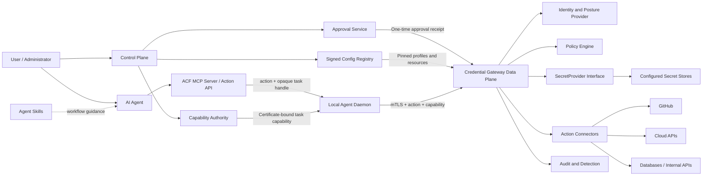
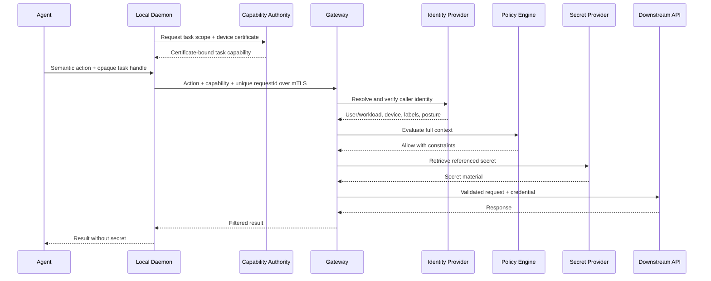
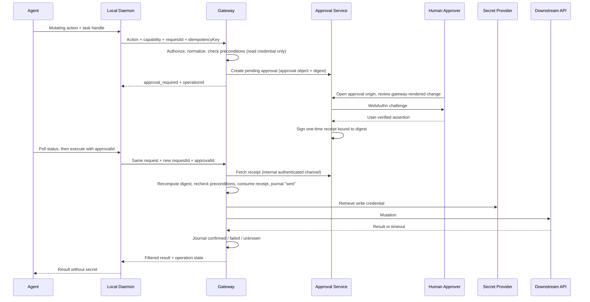

# Agent Credential Firewall — System Design

Status: Draft

Last updated: 2026-10-24

## 1. Overview

Agent Credential Firewall (ACF) is an identity-aware, task-scoped credential gateway for AI agents.

Its central security property is:

> An agent holds neither a secret nor a portable capability. It can only ask a daemon that is bound to a device identity and to a task authorization to have the gateway perform a normalized, audited semantic action. Where required, a human approves that exact action.

ACF sits between agents and credential-backed services. It authenticates the calling user, device, workload, and task; evaluates policy; obtains the required secret through a configured `SecretProvider`; and performs the requested semantic action without returning a reusable credential to the agent.

ACF is split into two planes:

- The **control plane** decides what may happen. It contains the Capability Authority, the Approval Service, and the Config Registry.
- The **data plane** enforces those decisions on each request. It contains the Credential Gateway, policy evaluation, secret providers, and connectors.

The initial deployment model assumes:

- Agents run on developer endpoints, trusted servers, VPS instances, and remote terminals.
- Each agent host runs an ACF daemon under a service identity separate from the agent.
- Daemons communicate with gateways over mutual TLS using a non-exportable device key.
- Secrets are stored in one or more configured secret providers.
- Gateways access providers only through the vendor-neutral `SecretProvider` interface.
- The gateway is deployed on dedicated, hardened infrastructure separate from agent workloads.

## 2. Problem statement

AI agents commonly consume bearer tokens through environment variables, configuration files, CI secrets, or shell sessions. This creates several problems:

- A copied bearer token can be replayed from another machine.
- Long-lived tokens survive beyond the task that required them.
- One shared token cannot identify the device, agent, or task that used it.
- Secrets can leak through logs, traces, shell history, child processes, crash dumps, or debugging tools.
- Prompt injection may persuade an agent to reveal a secret or use it against an attacker-controlled destination.
- Credentials are duplicated across laptops, VPS instances, build systems, and temporary terminals.
- Revocation and rotation become difficult because consumers are not centrally inventoried.
- Network identity alone cannot prove that an already authorized endpoint is not compromised.

Moving these tokens into a secrets manager improves storage, but does not solve the runtime exposure problem if agents can still retrieve raw values freely.

## 3. Goals

ACF should:

1. Keep secret-provider bootstrap credentials and downstream tokens away from agent hosts.
2. Prefer proxying authorized actions over returning secret values.
3. Bind authorization to user, device, workload, agent, task, resource, action, and time.
4. Support developer endpoints, unattended VPS workloads, and remote terminals.
5. Support pluggable connection identity, device identity, and posture providers.
6. Enforce least privilege across development and production environments.
7. Produce useful audit records without recording secret values.
8. Support rapid session revocation and device isolation.
9. Remain usable with multiple secret providers through a provider interface.
10. Fail closed when identity, policy, or secret retrieval cannot be verified.

## 4. Non-goals

The first version will not:

- Replace an organization's existing secret-management or key-management infrastructure.
- Replace an organization's identity provider or network access control system.
- Guarantee safety after a gateway host is fully compromised.
- Turn static third-party bearer tokens into cryptographically non-exportable credentials.
- Provide a general-purpose remote shell.
- Permit arbitrary secret retrieval from untrusted remote terminals.
- Automatically rotate every downstream credential type.
- Treat network membership or reachability alone as sufficient authorization.
- Inject static tokens into local processes or return raw secret leases. Local Lease Mode is removed from v1.
- Promise exactly-once or at-most-once downstream execution when the downstream API offers no idempotency mechanism.
- Distinguish a benign instruction from a malicious instruction inside an already authorized agent process.
- Provide rollback resistance for the encrypted local provider unless an external generation anchor is configured.

## 5. Threat model

### 5.1 Assets

- Secret-provider bootstrap credentials and encryption keys.
- Downstream API tokens, database credentials, certificates, and signing keys.
- Authorization policy and task capability definitions.
- Audit records and identity mappings.
- Gateway runtime memory.

### 5.2 Potential attackers

- Malicious content encountered by an agent, including prompt injection.
- A compromised developer endpoint.
- A compromised VPS or CI worker.
- A malicious or vulnerable agent tool or plugin.
- An authenticated node with valid connectivity but excessive permissions.
- An attacker with access to logs, traces, crash dumps, or backups.
- A malicious insider attempting to use legitimate infrastructure outside an approved task.

### 5.3 Trust assumptions

- Configured secret and identity providers behave according to their documented security models.
- Gateway hosts are more trusted and more tightly controlled than agent hosts.
- Connection and device identity do not prove that an endpoint is uncompromised.
- Downstream APIs correctly enforce the credentials and requests presented to them.
- Host-level root compromise can expose credentials currently in gateway memory.
- An agent with shell access can call anything its operating-system account can reach, including the daemon socket. The daemon key and capabilities must therefore live outside that account.
- The control-plane signing keys are protected from the data plane. A compromised gateway can misuse secrets it can already retrieve, but it cannot mint task capabilities or approval receipts.

## 6. Architecture



### 6.1 Trust boundaries

```text
Less trusted                         More trusted

User content / repositories
        ↓
Agent Skills and workflow instructions
        ↓
AI agent process
        ↓
MCP tools / structured action API
        ↓
Local agent daemon
        ↓  mTLS with non-exportable device key
Credential gateway data plane ← authenticated control plane
        ↓
Configured secret stores and approved downstream services
```

Agents and the content they process are treated as potentially hostile. The gateway is a high-value security boundary and must not execute agent-provided code.

### 6.2 Agent integration layers

ACF should support mainstream agent runtimes through a portable integration package containing Agent Skills and an MCP server or equivalent structured action API.

This follows the common plugin separation in which Skills provide reusable workflows and an MCP server provides controlled tools, authentication, authorization, and live actions. See the [OpenAI plugin architecture](https://developers.openai.com/plugins/concepts/plugins) for one concrete packaging model. ACF's gateway and action contracts remain agent-runtime agnostic.

```text
Agent Plugin / Integration Package
├── Skills
│   ├── acf-actions
│   ├── acf-cloudflare-dns
│   └── acf-connector-authoring
└── MCP Server / Action API Adapter
    ├── Resource discovery
    ├── Action discovery
    ├── Approval requests
    ├── Action execution
    └── Result verification
```

The layers have distinct responsibilities:

- **Skills** teach the model when and how to use ACF actions, including planning, approval, verification, and output expectations.
- **MCP tools or an equivalent action API** provide structured, bounded operations and machine-readable results.
- **The local daemon** attaches trusted local process, agent, device, and task context that the model cannot choose freely.
- **The gateway** authenticates, authorizes, retrieves credentials, executes connectors, and audits outcomes.

Skills are not part of the authorization boundary. A malicious, modified, or ignored skill must not enable an operation that the gateway would otherwise deny. Skills and adapters must never contain provider tokens, secret-provider bootstrap credentials, private keys, or production secret values.

The control plane and data plane are separate trust roles with separate signing keys, API surfaces, and deployment identities. §13.3 covers where each plane may run.

## 7. Core components

### 7.1 Agent Skills and MCP Adapter

The initial integration package should provide three focused skills:

- `acf-actions` for the generic discover, plan, approve, execute, and verify workflow.
- `acf-cloudflare-dns` for the first provider-specific workflow example.
- `acf-connector-authoring` for reviewing and developing provider profiles safely.

The MCP server or equivalent adapter should expose a small structured surface such as:

```text
acf_list_resources
acf_describe_resource
acf_describe_action
acf_request_task
acf_get_task_status
acf_execute_action
acf_request_approval
acf_get_request_status
acf_verify_action_result
```

- `acf_request_task` submits a proposed task scope. It returns an opaque task handle that is pending until the Capability Authority issues the capability.
- `acf_execute_action` and `acf_request_approval` take that handle. They never take a raw capability.
- `acf_get_request_status` takes an `operationId` and reports the operation state defined in §9.

Skills may sequence these tools but may not manufacture identity, approvals, task capabilities, or secret references. High-impact actions remain subject to server-side policy and approval enforcement.

### 7.2 Control plane

#### 7.2.1 Capability Authority

The Capability Authority issues task authorizations. It is a first-class ACF control-plane component, not an implied external orchestrator.

An agent may propose a task scope, but it cannot decide that scope. The daemon forwards the proposal over its mTLS connection, so the authority knows the device identity. The authority then computes the intersection of three things:

- The scope the agent requested.
- The caller's entitlements.
- Resource and administrative policy.

It issues a capability for that intersection only after one of these trusted authorization paths succeeds:

- **Human confirmation.** A human confirms the task scope through a WebAuthn-protected flow. The control plane renders that flow, not the agent.
- **Signed job definition.** An administrator-approved job definition authorizes an unattended workload.
- **Trusted scheduler.** A configured CI system or scheduler requests the task under policy configured in advance for that requester.

The authority returns the capability to the daemon only. The daemon holds it in memory or in an OS key store and gives the agent an opaque task handle.

Capability representation is a recorded decision. Capabilities are authority-signed and certificate-bound, and the gateway verifies them with the authority's public key. Revocation, usage counters, and quotas live in the shared security state (§9.4). As a result, the data plane cannot mint grants, and the gateway does not call the authority on every request. A server-side task session with an opaque reference remains an acceptable alternative for deployments that never need offline verification. The wire encoding, such as JWS with EdDSA, is fixed in an ADR.

#### 7.2.2 Approval Service

The Approval Service handles exact high-risk changes after task authorization. Task authorization and transaction approval are distinct:

- A **task capability** permits a bounded set of actions and resources for a short period.
- An **approval receipt** permits one exact, canonicalized mutation and is consumed once.

`acf_request_approval` only creates or retrieves a pending approval. It can never approve a request.

The Approval Service:

- Runs on its own web origin.
- Renders the gateway-normalized change itself.
- Authenticates the approver with WebAuthn user verification.

Production resources can require confirmation from a device other than the agent host. Receipts reach the gateway over an internal authenticated channel and never pass through the agent or the daemon. The protocol is defined in §10.

#### 7.2.3 Config Registry

The Config Registry holds connector profiles, resource registrations, secret registrations with their use bindings, and policies.

- Each item is versioned and content-addressed.
- An item enters production only after an administrator review produces a signature or a pinned digest.
- Profile authoring and secret-binding administration are separate permissions. Someone who can edit a profile cannot redirect where a secret may be used.
- A profile drafted by an agent, for example through the `acf-connector-authoring` skill, is inert until admitted.
- The gateway loads only signed or pinned bundles. Every audit event records the bundle digest it ran under.

In Milestone 1, the registry is a signed configuration bundle on disk. A configuration database is deferred.

### 7.3 Local Agent Daemon

The daemon provides a small local API to the agent and attaches trusted local context that the model cannot freely choose.

Responsibilities:

- Establish a mutually authenticated, encrypted connection to the gateway.
- Run under a service identity separate from the agent process where the operating system permits it.
- Expose a permissioned Unix socket and derive peer UID, PID, and executable context from `SO_PEERCRED` or an equivalent OS mechanism.
- Keep the mTLS private key in a TPM, Keychain, KMS agent, or other non-exportable system key store.
- Keep short-lived task capabilities in protected memory and expose only an opaque task handle to the agent.
- Remove credentials from logs and error reports.

The daemon is not trusted with a secret-provider bootstrap credential or storage-encryption key.

A launcher may register the agent's PID or cgroup with the daemon so that the daemon can scope a task handle to that process tree. This is useful hygiene, but it is not strong process authentication and must not be described as one.

Peer credentials establish operating-system provenance, not model intent. Shell commands launched by an authorized agent remain inside that agent's authority. ACF limits their impact through task scope, semantic actions, resource constraints, quotas, and approvals rather than claiming to distinguish a benign prompt from a malicious prompt inside the same process tree.

The daemon layer delivers a narrower guarantee. An agent that calls the daemon directly can misuse only the actions its task capability already allows, within their constraints and approval requirements. It cannot obtain the downstream credential or a capability it could carry to another host.

The gateway derives the daemon certificate directly from its TLS layer and compares it with the capability confirmation claim. If TLS terminates at a separate proxy, the proxy-to-gateway hop must be mutually authenticated and preserve the exact verified certificate identity; an untrusted forwarded header is insufficient.

### 7.4 Credential Gateway

The gateway is the main enforcement point.

Responsibilities:

- Resolve trusted caller, device, and workload identity from configured providers.
- Validate task capabilities and request freshness.
- Evaluate authorization policy.
- Verify secret use bindings before retrieval and before injection.
- Retrieve secrets through the configured provider.
- Build approval objects, consume approval receipts, and maintain the operation journal.
- Execute approved downstream actions.
- Enforce destination, method, resource, and response filtering.
- Emit tamper-evident audit events.
- Apply rate limits and anomaly controls.

The gateway must never expose a general-purpose `get any secret` endpoint to agents.

### 7.5 Identity Context Provider

The gateway should obtain identity and posture data through a provider interface rather than depend on a specific network or identity vendor:

```rust
#[async_trait]
pub trait IdentityContextProvider: Send + Sync {
    async fn resolve(&self, connection: &ConnectionInfo)
        -> Result<IdentityContext, IdentityError>;

    async fn verify(&self, identity: &IdentityContext)
        -> Result<(), IdentityError>;
}
```

Provider output must be derived from authenticated connection state or signed assertions. Identity headers supplied directly by an agent are untrusted unless a trusted intermediary removes and replaces them.

Possible implementations include mutual TLS, workload identity, signed device certificates, private-network identity, or an organization's existing identity-aware proxy.

### 7.6 Policy Engine

Authorization decisions should consider:

- User or workload identity.
- Device identity and labels.
- Device posture, when available.
- Agent identity and version.
- Task identifier and task issuer.
- Requested action and resource.
- Environment and region.
- Time window and capability TTL.
- Human approval state.
- Current risk signals.

Example decision input:

```json
{
  "subject": {
    "user": "alice@example.com",
    "device": "vps-agent-17",
    "labels": ["agent", "production"],
    "agent": "acf-agent-123"
  },
  "task": {
    "id": "fix-issue-892",
    "issuer": "acf-authority-prod",
    "expiresAt": "2026-10-24T15:30:00Z"
  },
  "request": {
    "action": "github.create_pull_request",
    "resource": "repo:example/backend"
  }
}
```

### 7.7 Secret Provider Interface

The gateway should isolate secret-manager-specific behavior behind an interface:

```rust
#[async_trait]
pub trait SecretProvider: Send + Sync {
    async fn get(&self, reference: &SecretRef)
        -> Result<ResolvedSecret, SecretError>;
}

pub struct ResolvedSecret {
    pub material: SecretMaterial,
    pub version: SecretVersion,
    /// Present only when the provider stores authenticated use-binding metadata.
    pub attested_binding: Option<SecretUseBinding>,
}
```

Runtime retrieval is intentionally minimal. Metadata enumeration, writes, rotation, backup, and restore belong to a separate `SecretAdmin` interface. That interface is not linked into the agent-facing request path.

Use bindings are verified in three places:

1. **Signed registry.** The secret registration in the Config Registry is the authoritative binding. The gateway checks it before calling `get()`.
2. **Provider attestation.** Providers that can store authenticated metadata, such as the encrypted local provider, also return an attested binding. That binding must match or be narrower than the registry binding.
3. **Connector.** The connector checks the resolved origin and credential slot again before injection.

Providers that cannot attest a binding, such as most external vaults, rely on the registry binding alone.

The core implementation is provider-neutral. Initial implementations should include an in-memory test provider and an encrypted local provider. External adapters may integrate with third-party secret managers without changing gateway, policy, connector, or agent contracts.

Secret values must be represented by types that discourage logging, serialization, and accidental string formatting.

### 7.8 Action Connectors

Action connectors use credentials without revealing them to the agent. The gateway core must not contain one hard-coded implementation for every token-using service. Connector support is divided into three layers.

#### 7.8.1 Declarative HTTP provider profiles

Most REST APIs that use bearer tokens, API-key headers, or basic authentication should be supported by a generic HTTP connector runtime and an administrator-reviewed provider profile.

A provider profile defines:

- A fixed base URL and allowed ports.
- Named semantic actions.
- HTTP method and path templates for each action.
- Parameter and body schemas.
- Authentication strategy and credential slot.
- Redirect behavior.
- Request and response header filters.
- Response-field filters.
- Whether an action is read-only, mutating, or approval-gated.
- How each parameter is classified for audit: record it, hash it, or omit it.
- A profile identifier and content digest or administrator signature.

Response filtering is deny by default. A profile must explicitly name every response field that may cross the gateway boundary. Response headers are also deny by default.

Profiles may reference only built-in domain types, such as `dns_name`, `ipv4`, `ipv6`, and `dns_record_content`. Each domain type is a reviewed Rust normalizer and validator. A profile cannot define new normalization logic.

Provider profiles contain no secret values. Resource registrations bind credential slots to logical `SecretRef` values.

#### 7.8.2 Reusable authentication strategies

The connector runtime should provide a small set of reusable authentication modules:

```rust
enum AuthenticationStrategy {
    BearerToken,
    HeaderApiKey { header: HeaderName },
    BasicAuth,
    OAuth2ClientCredentials,
    OAuth2RefreshToken,
    AwsSigV4,
}
```

Not every strategy must be implemented in the first release. The abstraction prevents authentication behavior from being duplicated across provider profiles.

#### 7.8.3 Native connectors

A dedicated Rust connector is appropriate when a service requires:

- A non-HTTP protocol such as a database or SSH protocol.
- Complex request signing or key handling.
- Multi-step transactions, rollback, or conflict detection.
- Complex OAuth or installation-token exchange.
- Provider-specific response filtering or safety invariants.
- Semantics that cannot be expressed safely by the declarative profile.

Initial native connectors may include database execution, SSH certificate use, GitHub App authentication, and Kubernetes API integration.

Native and declarative connectors implement the same interface:

```rust
pub trait ActionConnector {
    fn descriptor(&self) -> ConnectorDescriptor;

    async fn execute(
        &self,
        context: &AuthorizedContext,
        request: ActionRequest,
        credentials: CredentialSet,
    ) -> Result<ActionResponse, ConnectorError>;
}
```

#### 7.8.4 Connector security boundary

Agents select only a logical action, resource, and validated parameters. Agents must not select:

- A secret reference.
- An authentication strategy.
- A credential-injection destination.
- An arbitrary absolute URL.
- An `Authorization` or API-key header.
- Redirect behavior.

The gateway resolves these values from trusted provider and resource configuration. A generic unrestricted HTTP proxy would create a secret-exfiltration and server-side request forgery primitive and is therefore forbidden.

Template namespaces are explicit:

- Trusted resource bindings use `{resource.name}`.
- Agent-supplied, schema-validated values use `{params.name}`.

A parameter can never shadow a resource binding. A `{params.*}` value fills exactly one percent-encoded path segment. It must not contain `/`, and it must not decode to `.` or `..`.

Every credential has a use binding that limits it to an allowed connector, origin, authentication slot, and environment (§8.4). An administrator-reviewed profile must be activated through the signed or hash-pinned Config Registry (§7.2.3). An agent-authored profile is never active merely because it exists in a workspace.

OpenAPI documents may be used to generate an initial provider profile, but generated profiles are untrusted input until an administrator reviews their hosts, endpoints, schemas, credential placement, response filtering, and approval requirements.

### 7.9 Example: Cloudflare DNS

This example shows the complete lifecycle for an agent that needs to inspect and create DNS records without receiving a Cloudflare API token.

#### 7.9.1 Credential provisioning

The administrator creates two Cloudflare API tokens scoped to one specific zone:

```text
acf-example-com-dns-read
  Permission: Zone / DNS Read
  Resource:   Specific zone / example.com

acf-example-com-dns-write
  Permission: Zone / DNS Write
  Resource:   Specific zone / example.com
```

Read and write credentials are separated so a read request retrieves and decrypts only the read token. The tokens are stored through a configured secret provider, for example:

```text
Provider namespace: production/cloudflare

cloudflare/example.com/dns-read
cloudflare/example.com/dns-write
```

Only the appropriate gateway security identity can resolve these references. The agent has no direct provider access.

Cloudflare documents `DNS Read` and `DNS Write` as zone permissions and recommends scoped API tokens instead of the legacy global API key. See the [Cloudflare API token permissions](https://developers.cloudflare.com/fundamentals/api/reference/permissions/).

Each secret record is also bound to `connector=cloudflare`, `origin=https://api.cloudflare.com`, the appropriate credential slot, and its environment. A configuration error cannot redirect a Cloudflare token to another connector or origin.

#### 7.9.2 Declarative provider profile

Cloudflare DNS can initially use the generic HTTP connector:

```yaml
schema: acf.profile/v1
connector: cloudflare
revision: 1
base_url: https://api.cloudflare.com/client/v4
authentication:
  strategy: bearer

actions:
  cloudflare.dns.records.list:
    method: GET
    path: /zones/{resource.zone_id}/dns_records
    credential_slot: read
    classification: read
    params:
      name: { location: query, type: dns_name }
      type: { location: query, type: string, enum: [A, AAAA, CNAME, TXT, MX] }
    response:
      fields: [success, errors, result.id, result.type, result.name, result.content, result.ttl, result.proxied]
    audit:
      record: [name, type]

  cloudflare.dns.records.create:
    method: POST
    path: /zones/{resource.zone_id}/dns_records
    credential_slot: write
    classification: mutate        # approval is required by default and cannot be disabled
    params:
      type: { location: body, type: string, required: true, enum: [A, AAAA, CNAME, TXT] }
      name: { location: body, type: dns_name, required: true }
      content: { location: body, type: dns_record_content, required: true, record_type_param: type, max_length: 2048 }
      ttl: { location: body, type: integer, min: 60, max: 86400 }
      proxied: { location: body, type: boolean }
    response:
      fields: [success, errors, result.id, result.type, result.name, result.content, result.ttl, result.proxied]
    audit:
      record: [type, name, content, ttl, proxied]
```

The schema is versioned as `acf.profile/v1`. The loader enforces these rules:

- **Unknown and duplicate keys** are rejected.
- **`response.fields` is required.** An explicit empty list returns no business payload.
- **Unlisted parameters** are left out of audit events.
- **`location: path` parameters** must appear exactly once in the path template as `{params.<name>}`.

`dns_record_content` validates the content according to the record type:

- `A` content must be an IPv4 address.
- `AAAA` content must be an IPv6 address.
- `CNAME` content must be a normalized DNS name.
- `TXT` content must be bounded text.

The list and create actions map to Cloudflare's documented `GET /zones/{zone_id}/dns_records` and `POST /zones/{zone_id}/dns_records` endpoints. See the [Cloudflare DNS Records API](https://developers.cloudflare.com/api/resources/dns/subresources/records/).

#### 7.9.3 Resource registration

The administrator registers the actual zone and binds credential slots to logical provider-neutral secret references:

```yaml
resources:
  "cloudflare-zone:example.com":
    connector: cloudflare
    environment: production
    bindings:
      zone_id: 023e105f4ecef8ad9ca31a8372d0c353
    credentials:
      read: secret://production/cloudflare/example.com/dns-read
      write: secret://production/cloudflare/example.com/dns-write
    constraints:
      params.type: { in: [A, AAAA, CNAME, TXT] }
      params.name:
        dns_within: example.com
        not_in: ["example.com", "mail.example.com"]
        allow_wildcard: false
      params.ttl: { range: [60, 86400] }
      quotas: { mutations_per_task: 5 }

secrets:
  "secret://production/cloudflare/example.com/dns-read":
    use_binding:
      connectors: [cloudflare]
      origins: ["https://api.cloudflare.com"]
      auth_slot: read
      environment: production
  "secret://production/cloudflare/example.com/dns-write":
    use_binding:
      connectors: [cloudflare]
      origins: ["https://api.cloudflare.com"]
      auth_slot: write
      environment: production
```

The URI beginning with `secret://` is an ACF logical reference, not a secret value. Provider configuration maps its namespace to a concrete local or remote secret store. Resource registrations and secret registrations are administered under separate permissions (§7.2.3).

The loader also cross-checks the resource against its profile:

- **Bindings.** The resource must supply every `{resource.*}` binding the profile's paths use, and no others.
- **Credential slots.** The resource must supply every credential slot the profile's actions use, and no others.
- **Secret registrations.** Each secret it references must be registered, and that registration's use binding must permit this connector, the profile's origin, the slot, and the environment.
- **Constraints.** Constraints may name only parameters that the profile declares. `actions.deny` may name only actions that the profile defines. A typo is rejected instead of silently leaving an action allowed.

The complete example is a test fixture in `crates/acf-config/tests/fixtures/cloudflare-production.yaml`.

The connector normalizes DNS values before policy evaluation: Unicode names are converted to their canonical IDNA form, ASCII is lowercased, a trailing root dot is handled consistently, relative names are rejected, and wildcard syntax is parsed rather than matched as an untrusted raw string. The generic runtime provides typed constraints; connector-specific normalizers provide domain semantics.

#### 7.9.4 Query interaction

The user asks the agent to inspect `api.example.com`. The agent calls `acf_request_task` with a proposed scope. The user confirms that scope in the control-plane UI. The Capability Authority then issues a short-lived capability to the daemon. Its claims are:

```json
{
  "iss": "acf-authority-prod",
  "aud": "acf-gateway-prod-eu",
  "sub": "user:alice@example.com/device:laptop-0142",
  "jti": "cap-01JB...",
  "iat": 1792863900,
  "nbf": 1792863900,
  "exp": 1792865700,
  "cnf": { "x5t#S256": "base64url-sha256-of-daemon-certificate" },
  "task": {
    "id": "dns-change-892",
    "basis": { "type": "human", "approver": "alice@example.com", "method": "webauthn" }
  },
  "grants": [
    {
      "action": "cloudflare.dns.records.list",
      "resource": "cloudflare-zone:example.com",
      "constraints": {
        "params.name": { "in": ["api.example.com"] },
        "params.type": { "in": ["A"] }
      }
    },
    {
      "action": "cloudflare.dns.records.create",
      "resource": "cloudflare-zone:example.com",
      "constraints": {
        "params.name": { "in": ["api.example.com"] },
        "params.type": { "in": ["A"] }
      }
    }
  ],
  "limits": { "maxRequests": 50, "maxMutations": 1 }
}
```

Capability constraints use the same typed constraint language as resource registrations (§8.3). The agent sees only the task handle. The daemon sends the following semantic request to the gateway, attaching the capability and a fresh `requestId`:

```json
{
  "requestId": "req-001",
  "taskId": "dns-change-892",
  "action": "cloudflare.dns.records.list",
  "resource": "cloudflare-zone:example.com",
  "parameters": {
    "name": "api.example.com",
    "type": "A"
  }
}
```

The gateway:

1. Verifies connection identity and the task capability.
2. Confirms that the action, zone, name, and record type are allowed.
3. Resolves the resource's `read` credential slot.
4. Retrieves the read token through the configured `SecretProvider`.
5. Injects the bearer token into the fixed Cloudflare request.
6. Filters the provider response.
7. Returns DNS data without returning the token.
8. Emits a redacted audit event.

#### 7.9.5 Mutating interaction and approval

The task capability grants `create`, but each mutation still needs its own transaction approval (§10). To create a record, the daemon submits:

```json
{
  "requestId": "req-002",
  "idempotencyKey": "op-01JB...",
  "taskId": "dns-change-892",
  "action": "cloudflare.dns.records.create",
  "resource": "cloudflare-zone:example.com",
  "parameters": {
    "type": "A",
    "name": "api.example.com",
    "content": "203.0.113.10",
    "ttl": 300,
    "proxied": true
  }
}
```

Before it creates an approval, the gateway does two things:

- It normalizes and validates the task capability, record name, zone, record type, content, TTL, mutation quota, and applicable policy.
- It issues a read request with the read credential to evaluate preconditions, such as "no record with this name and type exists".

It does not retrieve the write credential at this stage.

The action is approval-gated, so the gateway records an operation in the `awaiting_approval` state and returns the exact proposed change. The gateway renders this change. The agent does not write it.

```json
{
  "status": "approval_required",
  "operationId": "op-01JB...",
  "approvalId": "approval-123",
  "approvalDigest": "sha256:9f2c...",
  "change": {
    "zone": "example.com",
    "operation": "create",
    "record": {
      "type": "A",
      "name": "api.example.com",
      "content": "203.0.113.10",
      "ttl": 300,
      "proxied": true
    },
    "preconditions": { "existing_records": { "name": "api.example.com", "type": "A", "count": 0 } }
  },
  "expiresAt": "2026-10-24T18:10:00Z"
}
```

The human opens the approval on the Approval Service origin, reviews the same change, and confirms it with WebAuthn. Meanwhile the agent polls `acf_get_request_status`.

Once the operation is `approved`, the daemon submits the request again with a new `requestId`, the same `idempotencyKey`, and the `approvalId`. The gateway then carries out these steps in order:

1. Recomputes the approval digest from the request it just received, the current profile digest, and the current policy version.
2. Fetches the receipt over its internal channel and checks that the digests match.
3. Re-evaluates the preconditions.
4. Atomically consumes the receipt.
5. Moves the operation to `sent` and retrieves the write token.
6. Calls Cloudflare, filters the result, and records the outcome as `confirmed`, `failed`, or `unknown`.

If anything changed in the meantime, the gateway rejects the request and requires a new approval. This covers a parameter, the profile, the policy version, or a precondition.

Mutations are never retried automatically. If the operation becomes `unknown`, reconciliation runs as described in §9.3.

#### 7.9.6 Audit and rotation

The audit event records identity, task, action, logical resource, approval, logical secret reference, requested DNS change (fields classified `record` by the profile), provider result, configuration bundle digest, and timestamps. It never records the bearer token, authorization header, provider bootstrap credential, storage-encryption key, or private keys.

Token rotation is an administrative workflow:

1. Create a new scoped Cloudflare token.
2. Verify that the token is active through Cloudflare's token verification endpoint.
3. Update the corresponding secret through the configured provider's administrative path.
4. Validate gateway use of the new token.
5. Revoke the old Cloudflare token.

For higher assurance, read and write credentials may be placed in separate provider namespaces or stores and consumed by separate gateway security domains. This limits a compromised read path from becoming a DNS mutation path.

This example illustrates the general ACF model: every service and resource is explicitly registered, but ordinary token-based REST services are added through reviewed semantic-action profiles and configuration rather than one-off gateway code. Connectors must parse and validate requests instead of accepting arbitrary URLs, methods, paths, or command lines.

## 8. Authorization model

ACF uses layered authorization:

1. **Network layer** — private routing and firewall rules control which nodes can reach a gateway.
2. **Connection identity** — the gateway authenticates the calling user, device, or workload through a configured identity mechanism.
3. **Device and workload assertions** — signed claims provide labels, posture, environment, and other trusted context.
4. **Task capability** — the Capability Authority grants a short-lived set of actions, resources, and constraints to one task.
5. **Gateway policy** — contextual policy produces the final allow or deny decision.
6. **Resource and profile constraints** — trusted configuration narrows parameters, destination, credentials, and response fields.
7. **Connector enforcement** — the connector normalizes and validates the exact downstream request.

No single layer is sufficient by itself. Effective permission is the intersection of every layer:

```text
EffectivePermission =
    DeviceIdentity
  ∩ TaskCapability
  ∩ GatewayPolicy
  ∩ ResourceConstraints
  ∩ ConnectorContract
```

Four rules follow from this:

- A deny, a validation failure, or a missing required input at any layer denies the request.
- Constraints from different layers are intersected.
- The strictest approval requirement wins.
- No allow decision can override another layer's deny.

Network-layer attributes, such as Tailscale application capabilities, feed the `DeviceIdentity` term. They can narrow permission but never widen it.

### 8.1 Example trusted identity context

```json
{
  "principal": "workload:agent-prod-17",
  "deviceId": "device-01JB...",
  "labels": ["agent", "production", "eu"],
  "posture": {
    "managed": true,
    "diskEncrypted": true,
    "lastVerifiedAt": "2026-10-24T15:00:00Z"
  },
  "issuer": "identity-provider",
  "expiresAt": "2026-10-24T15:15:00Z"
}
```

### 8.2 Task capability

A task capability is short-lived, audience-bound, and issued by the ACF Capability Authority. It should contain:

- Issuer and audience.
- Agent and task identifiers.
- Permitted actions and resources.
- Typed parameter, quota, and environment constraints.
- Issued-at, not-before, and expiration timestamps.
- A unique identifier for revocation and usage accounting.
- A `cnf.x5t#S256` claim binding it to the daemon's mTLS certificate as described by [RFC 8705](https://www.rfc-editor.org/rfc/rfc8705.html).
- The authorization basis: human confirmation, a signed job definition, or a trusted scheduler.

Task capabilities authorize requests to ACF; they must never contain downstream secrets. A capability may authorize multiple requests during its TTL. It is not consumed after its first use. Each action request instead carries a unique `requestId` that is checked in a replay cache. One-time approval receipts have their own nonce and consumption state.

The gateway compares the `cnf.x5t#S256` claim with the certificate presented on the current TLS connection. On a mismatch, it denies the request.

### 8.3 Constraint model

Constraints are enforced in three layers, in this order:

1. **Structure.** JSON Schema, or an equivalent, validates types, required fields, and bounds.
2. **Domain normalization.** The connector's action contract converts values to canonical form using built-in domain types. For example, `dns_name` lowercases ASCII, handles the trailing root dot, converts Unicode to IDNA A-labels, rejects relative names, and parses wildcard labels.
3. **Authorization constraints.** The policy layer evaluates typed constraints against the normalized values only.

Resource registrations, task capabilities, and gateway policy all use the same small, deterministic constraint language. It supports:

| Constraint | Applies to |
| --- | --- |
| `in` / `not_in` | Enumerated values |
| `range` | Integers |
| `dns_within` / `allow_wildcard` | DNS names |
| `glob` | Identifier strings |
| `actions.deny` | Action names |
| `quotas` | Per-task and per-principal counters |

Constraints from different sources are always intersected. The language is not Turing-complete and does no I/O.

Three evaluation rules apply:

- **Undeclared parameters.** A field constraint applies to an action only if the action declares that parameter.
- **Absent values.** When a constraint applies, a missing value is a violation. Omitting an optional parameter therefore cannot widen a request. For example, a list action constrained to `api.example.com` cannot list the whole zone.
- **Normalized values only.** Values are compared after normalization. A DNS value that is not already canonical fails the check.

Cedar is the preferred later policy engine (§21). Cedar does not replace the domain normalization in layer 2.

### 8.4 Secret use bindings

Every secret registration in the Config Registry declares a use binding:

```yaml
use_binding:
  connectors: [cloudflare]
  origins: ["https://api.cloudflare.com"]
  auth_slot: write
  environment: production
```

The gateway enforces the binding at three points:

- **Before retrieval.** The resource, connector, slot, and environment must match the registry binding.
- **After retrieval.** If the provider returns an attested binding, it must equal the registry binding or be narrower.
- **Before injection.** The connector checks the final origin, after DNS resolution and the redirect policy, and the credential slot.

A misconfigured or malicious resource registration therefore cannot send a credential to another connector or origin.

## 9. Request identifiers, replay, and mutation semantics

### 9.1 Identifiers

| Identifier | Scope | Reuse rule |
| --- | --- | --- |
| Capability `jti` | One task authorization | Reusable within TTL; revocable; usage counted |
| `requestId` | One HTTP call from daemon to gateway | Unique; rejected if seen within the replay window |
| Approval receipt nonce | One approved mutation | Consumed exactly once |
| `idempotencyKey` | One logical mutation across retries and approval | Same key with the same digest returns the existing operation; same key with a different digest is rejected |
| `operationId` | Journal record for one mutation | Read-only reference used for status and reconciliation |

Every request also carries a timestamp. The gateway rejects a request whose timestamp is outside the freshness window. The replay window covers the freshness window plus the allowed clock skew.

A single-node gateway that restarts without a durable replay cache must reject requests timestamped before its start time plus the freshness window.

### 9.2 Operation states

| From | To | Trigger |
| --- | --- | --- |
| `prepared` | `awaiting_approval` | Action is approval-gated |
| `prepared` | `sent` | Action needs no approval |
| `awaiting_approval` | `approved` | Valid receipt issued |
| `awaiting_approval` | `rejected` | Approver declines |
| `awaiting_approval`, `approved` | `expired` | Approval or receipt expires before execution |
| `approved` | `sent` | Receipt consumed; `sent` journaled before the downstream call |
| `sent` | `confirmed` / `failed` | Downstream result received |
| `sent` | `unknown` | Timeout or lost response |
| `unknown` | `confirmed` / `failed` | Reconciliation |

Read actions are not journaled as operations. Mutating actions without an approval requirement move from `prepared` directly to `sent`.

### 9.3 Downstream execution guarantees

ACF does not promise strict at-most-once downstream execution. If Cloudflare accepts a request and the response is lost, the gateway cannot know whether the change happened unless the API supports idempotency keys.

ACF guarantees the following instead:

- The gateway never retries a mutation automatically.
- The gateway writes the `sent` journal entry durably before the downstream call.
- If the outcome is ambiguous, the operation becomes `unknown`.
- Reconciliation resolves an `unknown` operation. It uses a connector-defined read query or an operator decision through `acf_get_request_status`.
- When the downstream API supports idempotency keys, the connector forwards a key derived from `idempotencyKey`.

### 9.4 Shared security state

Replay caches, revocation lists, capability usage counters, quotas, approval receipts, and the operation journal live behind a `StateStore` interface in `acf-state`.

- A single gateway node may use an embedded durable store.
- Multiple gateway instances in one security domain must share a strongly consistent store. Otherwise a nonce, receipt, or quota could be used once on each instance.

Revocation propagation latency is bounded and documented.

## 10. Approval protocol

### 10.1 Approval object

The gateway builds the approval object from the normalized request. It is the only source of truth for what is approved:

```json
{
  "version": 1,
  "taskId": "dns-change-892",
  "capabilityJti": "cap-01JB...",
  "action": "cloudflare.dns.records.create",
  "resource": "cloudflare-zone:example.com",
  "normalizedParams": { "type": "A", "name": "api.example.com", "content": "203.0.113.10", "ttl": 300, "proxied": true },
  "preconditions": { "existing_records": { "name": "api.example.com", "type": "A", "count": 0 } },
  "profileDigest": "sha256:...",
  "policyVersion": "policy-2026-10-24.3",
  "idempotencyKey": "op-01JB...",
  "expiresAt": "2026-10-24T18:10:00Z"
}
```

The digest is computed in two steps. The object is serialized with the [RFC 8785 JSON Canonicalization Scheme](https://www.rfc-editor.org/rfc/rfc8785.html), and the result is hashed with SHA-256.

### 10.2 Approval channel

- `acf_request_approval` and gated `acf_execute_action` calls create a pending approval. They can never complete one.
- The Approval Service runs on its own web origin behind an identity-aware entry point, separate from the data-plane action API.
- The service renders the approval object itself. Agent-written descriptions are never shown as the authoritative content.
- The approver authenticates with WebAuthn user verification. The approver must be a principal authorized by policy for the resource. The requesting agent's workload identity can never approve.
- Production resources can require the approval to come from a device other than the agent host.

### 10.3 Receipt

A receipt binds these fields:

- The approval digest.
- The approver identity and the WebAuthn assertion reference.
- The approval time and expiry.
- A one-time nonce.

The Approval Service signs receipts with a key held only by the control plane. The gateway fetches receipts over an internal authenticated channel. A receipt is consumed atomically in the shared state store, and a second use is denied.

## 11. Credential usage mode

### 11.1 Proxy Mode

The gateway obtains the secret and performs the downstream request. The agent receives only a filtered business response.

Advantages:

- The downstream credential never reaches the agent host.
- Destination and operation restrictions can be enforced centrally.
- Prompt injection cannot directly print or exfiltrate the credential.
- Usage is attributable to a device, agent, and task.

ACF v1 does not inject static tokens into local processes and does not return raw secret leases. A future compatibility mode may broker downstream-native short-lived credentials such as STS credentials or GitHub App installation tokens, but only when the downstream service provides its own expiry and scope enforcement.

## 12. Request flows

### 12.1 Read action



Requests must include a unique request identifier. The gateway rejects expired or revoked capabilities, certificate-binding mismatches, replayed request identifiers, unexpected destinations, and policy/identity mismatches. Capability `jti` values identify task grants and are not treated as single-use nonces.

### 12.2 Approved mutation



## 13. Deployment model

### 13.1 Recommended topology

```text
Private network / authenticated service fabric
├── gateway-dev-01        role=gateway, env=dev
├── gateway-prod-eu-01    role=gateway, env=prod, region=eu
├── gateway-prod-eu-02    role=gateway, env=prod, region=eu
├── laptop-agents         user and device identities
├── vps-agent-dev         role=agent, env=dev
└── vps-agent-prod        role=agent, env=prod
```

Gateways should:

- Run on dedicated, hardened hosts.
- Be separate from hosts executing agents or user-provided code.
- Keep the data-plane action API off the public Internet and listen only on a private interface or authenticated service endpoint.
- Host any externally reachable approval UI on a separate control-plane origin with strong user authentication; it must not expose the action API.
- Permit outbound access only to configured remote providers, audit infrastructure, and approved downstream services.
- Use separate provider identities, namespaces, or bootstrap credentials per gateway security domain and environment.
- Keep secret values in memory for the shortest practical duration.
- Be deployed redundantly for production availability.

At minimum, development and production must use separate gateways and provider namespaces or access identities.

### 13.2 Endpoint classes

#### Developer endpoints

- Use user and device identity together.
- Require posture checks for sensitive environments.
- Require confirmation for high-impact production actions.
- Default to development resources.

#### Unattended VPS agents

- Use tagged workload/device identity instead of personal identity.
- Give each VPS or workload a unique agent identity.
- Restrict actions and resources per workload.
- Avoid storing remote-provider bootstrap credentials on agent VPS instances.

#### Remote or unmanaged terminals

- Never return raw production secrets.
- Allow only semantic proxy actions executed by the gateway.
- Use very short task capabilities and approval for sensitive operations.

### 13.3 Control-plane placement

- **Development.** The control plane and the gateway may run as one Rust program. They must still be separate modules with separate signing keys, separate listeners, and separate API surfaces.
- **Production.** The two planes may be deployed separately. They should be, when the gateway host has a different risk profile from the authority's signing keys.

The Approval Service origin may be reachable through an identity-aware HTTPS entry point. The data-plane action API never is.

### 13.4 Deployment profiles

Every ACF binary runs under an explicit, fail-closed deployment profile: `development` or `production`.

Two controls work together to enforce this:

1. **Release artifacts.** Release builds omit test-only identity providers, key sources, and the in-memory provider wherever practical. A binary built with the development feature refuses to start under the `production` profile.
2. **Runtime validation.** Under the `production` profile, startup validation rejects:
   - Development identities and insecure key sources.
   - The in-memory provider.
   - Unsigned or unpinned configuration bundles.
   - Capabilities that are not certificate-bound.
   - Plaintext listeners.
   - Loopback or test destinations in profiles.
   - A missing required audit sink.
   - An encrypted local provider that has neither a rollback anchor nor an explicit `rollback_resistance: none` acknowledgement.

A compile-time feature alone is never the security boundary. Every binary reports its build flavor and deployment profile in its audit events.

## 14. Secret provider integration

ACF resolves a logical `SecretRef` through a configured provider registry:

```yaml
secret_providers:
  production:
    type: encrypted-local
    path: /var/lib/acf
    key_source: systemd-credential
    rollback_anchor: tpm-nv

  enterprise:
    type: external
    adapter: organization-vault
    settings:
      server: https://vault.example.com
```

A resource refers only to a logical name:

```text
secret://production/cloudflare/example.com/dns-write
```

The provider registry maps `production` to an implementation. Agent requests and connector profiles cannot choose or override that mapping.

### 14.1 Provider categories

- **In-memory provider** — deterministic tests and local development; never production persistence.
- **Encrypted local provider** — encrypted storage on gateway-controlled disk for self-hosted deployments.
- **External provider adapter** — an integration with an existing secret manager or HSM-backed service.

All providers must implement the same runtime conformance suite covering exact-reference retrieval, redaction, error mapping, namespace isolation, and cancellation. Administrative metadata operations have a separate `SecretAdmin` interface and conformance suite.

There is exactly one in-memory provider. It serves both tests and the `development` profile. The design has no separate mock provider.

### 14.2 Encrypted local provider

The encrypted local provider stores ciphertext in a gateway-controlled directory, such as `/var/lib/acf/`. It must use authenticated encryption through a reviewed cryptographic library and a versioned storage format.

The key-encryption key must not be stored next to the encrypted data file. Supported key sources may include:

- TPM- or hardware-backed unsealing.
- A cloud KMS or HSM.
- An operating-system credential facility.
- A root-only file mounted from a separately protected volume.
- Interactive operator unlock for small or offline deployments.

If ciphertext and its effective decryption key are stored on the same VPS disk under the same protection boundary, encryption protects backups and some disk-theft scenarios but does not protect against full host compromise.

The provider encrypts records independently so `get()` decrypts only the requested record. It must support:

- Atomic manifest updates.
- File locking.
- Explicit backup procedures.
- Strict filesystem permissions.
- Bounded plaintext lifetime.
- Zeroization where it can be done reliably.

Rollback resistance requires a generation anchor outside the encrypted store, such as TPM monotonic state, KMS state, or a remotely signed checkpoint. Without such an anchor, the provider must not claim rollback protection. It provides integrity only and states so in its status output.

The provider must never expose a general-purpose decryption endpoint to agents.

Detailed local-storage requirements live in [Encrypted local provider](providers/encrypted-local.md). External integrations belong in separate provider-specific documents and adapters.

## 15. Audit and detection

Every decision should emit a structured event containing:

- Request and task identifiers.
- User, device, agent, and gateway identities.
- Requested and resolved action/resource.
- Policy decision and matched policy version.
- Connector and secret reference identifiers.
- Configuration bundle digest, build flavor, and deployment profile.
- Downstream status and latency.
- Approval reference and operation state, when applicable.
- Risk signals and denial reason.

Audit events must not contain:

- Secret values.
- Authorization headers.
- Raw request bodies that may contain credentials.
- Unfiltered downstream responses.

Request parameters enter audit events according to the action contract's per-field classification: `record`, `hash`, or `omit`. A field without a classification defaults to `omit`.

Tamper evidence requires an external anchor. A deployment must use one of two options:

- A local hash chain plus signed checkpoints published periodically to an external append-only sink.
- Direct writes to a remote append-only sink.

A local hash chain alone is never sufficient. An attacker with host control can truncate or replace the entire log.

Useful detections include unusual request volume, new resource access, off-hours production use, repeated denials, request-ID replay, certificate-binding failure, and a device accessing multiple unrelated security domains.

## 16. Failure behavior

ACF should fail closed when:

- Connection identity cannot be resolved or verified.
- Required device or workload assertions cannot be verified.
- The task capability is absent, invalid, expired, or revoked, or its `cnf` claim does not match the client certificate.
- A `requestId` is replayed or the request timestamp is outside the freshness window.
- Policy is unavailable or ambiguous.
- The configuration bundle is unsigned, unpinned, or fails validation under the `production` profile.
- The destination does not match the connector allowlist or the secret use binding.
- Secret retrieval resolves an unexpected provider namespace, logical reference, version, or binding metadata.
- An approval receipt is missing, expired, already consumed, or bound to a different digest.
- A mutation precondition no longer holds at execution time.
- The shared state store is unavailable for replay, quota, receipt, or journal operations.
- The encrypted local provider detects a generation older than its rollback anchor.
- Audit emission required by policy cannot be completed.

Short, bounded caching may be supported for availability, but offline access to production secrets should be disabled by default.

## 17. Incident response

When a device or gateway is suspected of compromise:

1. Remove or quarantine the device through the configured network and identity controls.
2. Revoke active ACF task capabilities and sessions.
3. Stop the affected gateway instance when applicable.
4. Revoke or rotate its provider bootstrap credential or storage key when applicable.
5. Identify downstream credentials used during the exposure window.
6. Rotate affected credentials.
7. Correlate ACF audit events with secret-provider and downstream service logs.
8. Restore the node from a trusted image before re-enrollment.
9. Resolve every operation left in the `unknown` state during the exposure window.

If the control plane itself may be compromised, take these steps as well:

- Rotate the Capability Authority and Approval Service signing keys.
- Remove the old public keys from gateway trust configuration.
- Revoke every capability and receipt issued under the old keys.

## 18. API surface

Every API is action-oriented and versioned. Each plane exposes a separate surface.

**Daemon local API** (Unix socket, peer credentials; used by the MCP adapter and CLI):

```http
POST /v1/tasks                       # propose a task scope; returns an opaque task handle
GET  /v1/tasks/{handle}              # task status
POST /v1/actions/execute             # semantic action using a task handle
GET  /v1/operations/{operation_id}   # operation state
```

**Gateway data plane** (mTLS from daemons only):

```http
POST /v1/actions/execute             # read actions; gated mutations return approval_required
GET  /v1/operations/{operation_id}
GET  /healthz
```

**Control plane** (authenticated; separate listeners and keys):

```http
POST /v1/tasks                       # daemon proposes scope over mTLS
GET  /v1/tasks/{task_id}
POST /v1/tasks/{task_id}/revoke
POST /v1/sessions/revoke             # revoke every capability for a device or principal
GET  /approvals/{approval_id}        # Approval Service origin, human-facing
POST /approvals/{approval_id}/decision   # WebAuthn-verified decision
```

**Internal channel** (gateway ↔ control plane):

```http
POST /internal/v1/approvals              # gateway creates a pending approval
GET  /internal/v1/approvals/{id}/receipt # gateway fetches the signed receipt
GET  /internal/v1/revocations?since=...  # revocation feed
```

ACF never exposes any of the following:

```http
GET  /v1/secrets/{secret_id}/value
POST /v1/actions/http/request
```

It also offers no endpoint that accepts an arbitrary URL, method, or path from an agent.

Example action request from daemon to gateway:

```json
{
  "taskId": "fix-issue-892",
  "requestId": "01JB...",
  "timestamp": "2026-10-24T17:50:03Z",
  "idempotencyKey": "01JB...",
  "action": "github.create_pull_request",
  "resource": "repo:example/backend",
  "parameters": {
    "head": "agent/fix-892",
    "base": "main",
    "title": "Fix authorization check"
  }
}
```

## 19. Implementation technology

### 19.1 Decision

The security-sensitive enforcement and authority services will be implemented in Rust. This includes:

- Credential Gateway.
- Capability Authority and the Approval Service backend, including receipt signing.
- Local Agent Daemon.
- Secret-provider adapters, including the encrypted local provider.
- Identity and policy enforcement interfaces.
- Action connectors.
- Task-capability validation and audit event generation.

The administrative web UI and external orchestration integrations are not required to use Rust. They may use the technologies most appropriate for their product and operational requirements, provided they communicate with the Rust enforcement services through authenticated, versioned interfaces.

### 19.2 Rationale

Rust is selected because it:

- Supports memory-safe provider and connector implementations behind strict type boundaries.
- Provides memory and type safety appropriate for a long-running, high-privilege gateway.
- Produces self-contained binaries suitable for endpoints and VPS deployments.
- Supports a shared protocol and security-type implementation across the gateway and local daemon.
- Has mature asynchronous networking and TLS libraries.
- Allows secret-bearing types to restrict accidental formatting, cloning, serialization, and logging.

Rust memory safety does not by itself prevent secret exposure. Logs, traces, crash dumps, child processes, connector behavior, and downstream requests remain part of the security boundary.

### 19.3 Initial stack

The initial implementation should prefer:

| Concern | Technology |
| --- | --- |
| Async runtime | Tokio |
| HTTP server | Axum |
| HTTP client | Reqwest with rustls |
| TLS and mTLS | rustls |
| Serialization | Serde |
| CLI | Clap |
| Secret-bearing values | `secrecy` and `zeroize` |
| Structured telemetry | `tracing` |
| Secret providers | Trait-based adapters and encrypted local provider |

The first protocol should use HTTP/2 with JSON over TLS rather than a custom transport. gRPC may be added later if measurements demonstrate a need.

Deployment profiles and their startup validation are defined in §13.4.

### 19.4 Workspace structure

The repository should use a Cargo workspace with explicit security boundaries and a separate agent-integration layer:

```text
crates/
├── acf-gateway/          # Gateway service and request lifecycle
├── acf-control-plane/    # Capability authority and approval service
├── acf-agent/            # Endpoint and VPS daemon
├── acf-protocol/         # API models and task capabilities
├── acf-identity/         # Pluggable connection identity providers
├── acf-policy/           # Authorization decisions
├── acf-secrets/          # SecretProvider/SecretAdmin traits, protected types, in-memory provider
├── acf-provider-local/   # Encrypted local provider
├── acf-connectors/       # Downstream action connectors and domain types
├── acf-config/           # Signed profiles, resources, secret registrations, validation
├── acf-state/            # Replay, revocation, quotas, receipts, operation journal
└── acf-audit/            # Structured audit events

integrations/
├── mcp/                  # Thin MCP / structured-action adapter
└── agent-plugin/         # Portable agent integration package
    ├── plugin.json       # Plugin metadata
    ├── mcp.json          # MCP server declaration
    └── skills/
        ├── acf-actions/
        ├── acf-cloudflare-dns/
        └── acf-connector-authoring/

providers/
└── README.md             # Optional external-provider adapter contract
```

Shared crates must preserve dependency direction: provider and connector implementations may depend on core interfaces, but core policy and protocol crates must not depend on a particular provider. Skills and MCP adapters depend on the public action contract; the gateway must never depend on skill behavior for security decisions.

### 19.5 Secret-handling requirements

Rust code that handles secret material must:

- Use dedicated secret-bearing types instead of ordinary `String` values where practical.
- Avoid implementing or deriving `Debug`, `Display`, `Serialize`, or `Clone` for plaintext secret types.
- Redact secret fields from errors, traces, metrics, and audit events.
- Minimize plaintext lifetime and the number of memory copies.
- Zeroize owned plaintext buffers when their lifecycle ends where the implementation can do so reliably.
- Avoid passing secrets in command-line arguments or persisting them to disk.
- Document unavoidable plaintext boundaries, including TLS libraries and downstream SDKs.

## 20. Milestones

### M0 — non-production development skeleton

- `example.profile.get` end to end through the unified `POST /v1/actions/execute` API.
- In-memory provider, development identity, and the `development` deployment profile only.
- Restricted semantic HTTP connector with `{resource.*}`/`{params.*}` separation and default-deny response projection.
- Static deny-by-default policy with the typed constraint language.
- Canary leak tests. No production-security claim.

### M1 — secure read path

- Daemon isolation: a separate service identity, a non-exportable device key, and peer-credential Unix socket.
- mTLS device identity; the data plane is reachable only through a private, authenticated interface.
- Capability Authority issuing certificate-bound, reusable task capabilities, authorized by signed job definitions or trusted scheduler policy.
- Signed configuration bundles, secret use bindings, and `production` profile startup validation.
- Per-record encrypted local provider with optional rollback anchor.
- Request-ID replay protection, revocation, quotas, and rate limiting.
- Audit with external checkpoints or a remote append-only sink.

### M2 — mutation path

- Approval Service on its own origin with WebAuthn. M2 also adds human task confirmation through the same WebAuthn flow.
- RFC 8785 approval objects and one-time signed receipts.
- Operation journal, idempotency keys, no automatic mutation retry, and reconciliation.
- Cloudflare DNS list and create through the declarative profile and DNS domain types.

### M3 — extension

- Agent Skills and the MCP adapter.
- Cedar policy backend and policy analysis.
- High-availability gateways with a shared, strongly consistent state store.
- Additional secret providers (for example Bitwarden) and connectors (for example GitHub App).
- Posture-aware policy, anomaly detection, SIEM integration, credential inventory, and automated incident response.

Each milestone builds only on contracts that earlier milestones have verified. Cloudflare `create` does not depend on an approval system that has not yet been designed and implemented.

## 21. Open questions and recorded decisions

Recorded decisions:

- **Policy.** Typed static YAML policy runs through M2. Cedar is the preferred later engine because it has a native Rust implementation, schema validation, deny-by-default authorization semantics, and a formal model. Domain normalization stays in connector action contracts either way.
- **Task provenance.** The Capability Authority establishes task provenance. Valid bases are human WebAuthn confirmation (from M2), a signed job definition, or a trusted scheduler under configured policy. The agent never self-asserts it.
- **Capability representation.** Capabilities are authority-signed and certificate-bound (`cnf.x5t#S256`), and only the daemon holds them. Revocation and usage state are server-side. The wire encoding is fixed in an ADR.
- **Default approval.** Every `classification: mutate` action requires transaction approval. Production resources may additionally require approval from a second device. Production reads require task authorization but not per-request approval. Policy may add approval requirements but cannot weaken these defaults.
- **Responses.** Connector responses are deny by default and expose only profile-declared fields after connector normalization.
- **Local Lease Mode.** It is removed from v1. A future mode may broker only downstream-native short-lived credentials.

Remaining questions:

- Which secret types can be replaced by genuinely short-lived credentials?
- How should gateway bootstrap credentials be provisioned in self-hosted deployments?
- What is the acceptable behavior during secret-provider or identity-provider outages?
- Should tenants receive dedicated gateway instances or isolated logical partitions?

## 22. Security principles

1. Prefer actions over secrets.
2. Treat every agent as potentially influenced by hostile input.
3. Authenticate the connection; authorize the task and operation.
4. Separate environments and failure domains.
5. Minimize plaintext lifetime and copies.
6. Make every credential use attributable.
7. Do not rely on network location as authorization.
8. Design revocation and rotation before adding more connectors.
