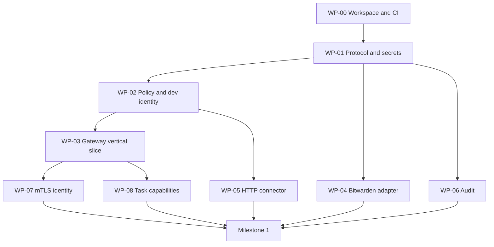

# Agent Credential Firewall — Implementation Plan

Status: Ready for implementation

Last updated: 2026-10-24

## 1. Purpose

This document is the execution blueprint for the first working version of Agent Credential Firewall (ACF). It turns the [system design](design.md) into independently assignable work packages with explicit dependencies and acceptance criteria.

The first milestone must prove one security property end to end:

> An agent can perform an authorized credential-backed action without receiving the reusable credential used for that action.

The implementation should remain deliberately small until this property is demonstrated and tested.

## 2. First demonstrable outcome

The initial demo consists of four processes or components:

```text
acf-agent
    ↓ authenticated action request
acf-gateway
    ↓ policy decision
SecretProvider
    ↓ secret material
HTTP Connector
    ↓ credential-injected request
Local Test Upstream
```

The operator runs:

```bash
acf-agent action execute \
  --action http.request \
  --resource demo-api \
  --method GET \
  --path /profile
```

The expected response contains business data only:

```json
{
  "user": "demo",
  "authenticated": true
}
```

The agent must never receive the upstream bearer token or the gateway's secret-provider credential.

## 3. Milestone acceptance criteria

Milestone 1 is complete only when all of the following are true:

- `acf-agent` can request one logical HTTP action from `acf-gateway`.
- The gateway authenticates a development identity.
- A deny-by-default policy authorizes an explicit action and resource.
- The gateway retrieves a credential through the `SecretProvider` interface.
- The HTTP connector injects the credential into an allowlisted upstream request.
- The agent receives a filtered upstream response without the credential.
- Unknown resources, methods, paths, and destinations are rejected.
- Secret values do not appear in application logs, audit events, errors, or HTTP responses.
- No secret is persisted to disk by ACF.
- Unit, integration, and negative security tests pass in CI.
- The same end-to-end test can run with a mock provider and the Bitwarden provider.

## 4. Delivery strategy

Implementation proceeds in three stages:

```text
Stage A: Safe local vertical slice
        ↓
Stage B: Real Bitwarden and authenticated transport
        ↓
Stage C: Production hardening
```

Do not begin with a control-plane UI, multi-tenancy, high availability, or a general-purpose policy language. Those features must build on a verified data plane.

## 5. Cargo workspace

The target workspace is:

```text
crates/
├── acf-gateway/          # Gateway binary and request lifecycle
├── acf-agent/            # Endpoint/VPS daemon and CLI
├── acf-protocol/         # API models and task capabilities
├── acf-identity/         # Connection identity providers
├── acf-policy/           # Authorization inputs and decisions
├── acf-secrets/          # SecretProvider trait and protected types
├── acf-bitwarden/        # Bitwarden Secrets Manager adapter
├── acf-connectors/       # Downstream action connectors
└── acf-audit/            # Structured, redacted audit events
```

Dependency direction:

```text
acf-protocol     acf-policy     acf-secrets     acf-audit
      ↑               ↑              ↑              ↑
      └──────────── acf-gateway ──────┴──────────────┘
                       ↑
              provider and connector implementations
```

Rules:

- Core interface crates must not depend on concrete providers.
- `acf-bitwarden` may depend on `acf-secrets`; the reverse is forbidden.
- Connectors may consume protected secret types but must not expose them through protocol models.
- API response types must not contain `SecretMaterial`.
- Binaries should have thin entry points; behavior belongs in testable libraries.

## 6. Work packages

### WP-00 — Repository and CI foundation

Dependencies: none

Deliverables:

- Root Cargo workspace.
- Empty crate structure with documented responsibilities.
- Pinned Rust toolchain policy.
- `rustfmt` and strict Clippy configuration.
- Unit-test and integration-test jobs.
- Dependency audit and license-policy jobs.
- Basic contributor commands in the README.

Required CI commands:

```bash
cargo fmt --all -- --check
cargo clippy --workspace --all-targets --all-features -- -D warnings
cargo test --workspace --all-features
cargo audit
cargo deny check
```

Acceptance criteria:

- A clean checkout passes all CI jobs.
- Every crate compiles with a minimal public API.
- No provider or network implementation is introduced in this package.

Primary file ownership:

- `/Cargo.toml`
- `/rust-toolchain.toml`
- `/.github/workflows/`
- `/deny.toml`
- Crate manifests only

### WP-01 — Core protocol and protected secret types

Dependencies: WP-00

Deliverables:

- Stable IDs for requests, tasks, resources, actions, agents, and devices.
- `ActionRequest` and `ActionResponse` protocol models.
- `SecretRef`, `SecretMetadata`, and `SecretMaterial` types.
- `SecretProvider` trait.
- Error taxonomy that does not embed plaintext secrets.
- Tests for redaction and serialization boundaries.

Required invariants:

- `SecretMaterial` does not implement `Display`.
- Plaintext secret types do not derive ordinary `Debug`, `Serialize`, or `Clone`.
- Protocol response types cannot serialize secret material.
- Secret-reference formatting is distinguishable from secret-value formatting.

Acceptance criteria:

- Compile-fail or equivalent tests demonstrate that secrets cannot enter response models accidentally.
- Redaction tests use a canary secret and assert that it is absent from formatted errors and debug output.

Primary file ownership:

- `/crates/acf-protocol/`
- `/crates/acf-secrets/`

### WP-02 — Policy engine and development identity

Dependencies: WP-00, protocol identifiers from WP-01

Deliverables:

- `IdentityContext` and `AuthorizationRequest` models.
- `PolicyEngine` trait.
- Deny-by-default static policy implementation.
- Development-only identity provider.
- Exact action/resource/method/path authorization.
- Decision reason codes suitable for audit events.

Example policy:

```yaml
principals:
  dev-agent:
    allow:
      - action: http.request
        resource: demo-api
        methods: [GET]
        paths: [/profile]
```

Acceptance criteria:

- Missing policy produces deny.
- A broader resource rule does not silently match a narrower resource unless explicitly supported.
- Policy tests cover allow, deny, malformed input, unknown principal, and unknown resource.
- Development identity is impossible to enable accidentally in a production build or production configuration.

Primary file ownership:

- `/crates/acf-identity/`
- `/crates/acf-policy/`

### WP-03 — Gateway and agent vertical slice

Dependencies: WP-01, WP-02

Deliverables:

- `acf-gateway` binary with health and action endpoints.
- `acf-agent` CLI capable of sending an action request.
- Request ID generation and propagation.
- Request body and response size limits.
- Timeouts and cancellation.
- `MockSecretProvider` integration.
- Local test-upstream fixture.

Initial endpoints:

```http
GET  /healthz
POST /v1/actions/execute
```

Acceptance criteria:

- The local demo completes successfully with a mock provider.
- Authorization occurs before secret retrieval.
- Secret retrieval occurs before connector execution and only after allow.
- Denied requests do not invoke the secret provider.
- Request cancellation does not leave background credential-bearing work running indefinitely.

Primary file ownership:

- `/crates/acf-gateway/`
- `/crates/acf-agent/`
- `/tests/e2e/`, if introduced

### WP-04 — Bitwarden provider spike and adapter

Dependencies: WP-00, `SecretProvider` from WP-01

This package may begin in parallel with WP-02 and WP-03 after the `SecretProvider` interface is merged.

Deliverables:

- A minimal technical spike proving SDK initialization, authentication, and secret retrieval.
- Production-shaped `BitwardenSecretProvider` adapter.
- Configuration for server URL, organization/project scope, and secret references.
- Bounded session behavior and explicit error mapping.
- Mockable wrapper around the external SDK boundary.
- Integration test instructions that do not require contributors to commit credentials.

Questions the spike must answer:

- Which SDK crate and versioning strategy will be used?
- How is the SDK client initialized and reused safely?
- What values are returned in SDK errors?
- How many plaintext copies are created during retrieval and conversion?
- How does authentication/session expiration appear to the caller?
- Which operations are stable across the SDK version selected for the MVP?

Development bootstrap:

- A Bitwarden access token may be supplied through an environment variable for local development only.
- The token must never be accepted as a CLI argument.
- Tests and documentation must use placeholders, never real credentials.

Acceptance criteria:

- A manually enabled integration test retrieves one test secret by reference.
- Unit tests run without network access or real credentials.
- SDK errors are mapped without logging credentials or secret values.
- The adapter returns `SecretMaterial`, not a raw `String` through its public interface.

Primary file ownership:

- `/crates/acf-bitwarden/`
- Bitwarden-specific integration tests and documentation

### WP-05 — Restricted HTTP action connector

Dependencies: WP-01, policy models from WP-02

This package may begin in parallel with WP-03 and WP-04 once protocol and policy request types are stable.

Deliverables:

- `ActionConnector` trait.
- HTTP connector with resource-based configuration.
- Credential injection performed inside the connector.
- Host, scheme, port, method, and path allowlists.
- Redirect policy.
- Request and response header filtering.
- DNS and address validation to reduce server-side request forgery risk.
- Body and response size limits.

Example resource configuration:

```yaml
resources:
  demo-api:
    base_url: https://api.example.test
    secret_ref: bitwarden://secret/example-id
    authorization:
      scheme: bearer
    allowed_methods: [GET]
    allowed_paths: [/profile]
```

The connector must reject:

- Agent-supplied absolute URLs.
- Agent-supplied authorization headers.
- Unsupported URL schemes.
- Unknown hosts or ports.
- Redirects to a different origin.
- Loopback, link-local, and cloud metadata destinations unless explicitly configured for a test fixture.
- Invalid path normalization and traversal attempts.
- Oversized request or response bodies.

Acceptance criteria:

- The connector successfully calls the local test upstream with an injected canary credential.
- The canary credential is not present in the connector response or logs.
- Negative tests cover host confusion, redirects, encoded traversal, DNS/address restrictions, and header injection.

Primary file ownership:

- `/crates/acf-connectors/`

### WP-06 — Audit events and leak-detection tests

Dependencies: WP-01; may proceed in parallel after shared IDs are stable

Deliverables:

- Versioned audit-event schema.
- Audit sink trait and development JSON-lines sink.
- Mandatory fields for identity, task, action, resource, decision, secret reference, connector outcome, and policy version.
- Central redaction utilities.
- Canary-secret leak test harness.

Audit events must not contain:

- Secret values.
- Authorization headers.
- Secret-provider credentials.
- Private keys.
- Unfiltered request or response bodies.

Acceptance criteria:

- Allow and deny paths both emit attributable events.
- Tests scan stdout, stderr, audit output, formatted errors, and HTTP responses for the canary secret.
- Audit sink failure follows explicit policy rather than silently dropping required events.

Primary file ownership:

- `/crates/acf-audit/`
- Shared redaction test utilities

### WP-07 — TLS 1.3 and mutual client authentication

Dependencies: working WP-03 vertical slice, identity models from WP-02

Deliverables:

- TLS configuration using rustls.
- Server-certificate validation.
- Mutual TLS client authentication.
- Certificate-to-`IdentityContext` mapping.
- Development CA and certificate-generation instructions for tests only.
- Certificate reload/rotation behavior.
- Explicit minimum protocol and cipher policy.

Acceptance criteria:

- Connections without a trusted client certificate fail during TLS establishment.
- A valid client identity reaches policy evaluation.
- An expired, untrusted, or incorrectly scoped certificate is rejected.
- The gateway does not accept agent-supplied identity headers as a substitute for verified connection identity.
- Mutating operations do not rely on TLS 0-RTT.

Primary file ownership:

- TLS integration in `/crates/acf-gateway/`
- Production identity provider in `/crates/acf-identity/`
- Certificate test fixtures

### WP-08 — Signed task capabilities and replay protection

Dependencies: WP-01, WP-02, WP-03

Deliverables:

- Versioned task-capability claims.
- Signature verification abstraction.
- Issuer and audience validation.
- `iat`, `nbf`, and `exp` enforcement.
- Action and resource restrictions.
- `jti` or equivalent unique capability identifier.
- Bounded replay cache.
- Revocation interface.

Acceptance criteria:

- Expired, not-yet-valid, wrong-audience, wrong-resource, and replayed capabilities are rejected.
- One task capability cannot authorize an action not present in its claims.
- Capability contents never include downstream credentials.
- Clock-skew behavior is explicit and tested.

Primary file ownership:

- Capability models in `/crates/acf-protocol/`
- Verification and replay logic in `/crates/acf-policy/` or a dedicated crate if justified

## 7. Dependency and merge order



Recommended merge order:

1. WP-00
2. WP-01
3. WP-02, WP-04, and WP-06 in parallel
4. WP-03 and WP-05 in parallel after their interfaces stabilize
5. WP-07 and WP-08 in parallel
6. Milestone integration and security review

## 8. Suggested parallel agent allocation

After WP-00 and the minimum WP-01 interfaces merge, work can be distributed as follows:

| Agent lane | Primary work | Avoid editing |
| --- | --- | --- |
| Core | WP-01 and protocol review | Provider and binary implementations |
| Authorization | WP-02 and WP-08 | Bitwarden and connectors |
| Provider | WP-04 | Core protocol except through review requests |
| Gateway | WP-03 and WP-07 integration | Provider internals |
| Connector | WP-05 | Gateway lifecycle and Bitwarden internals |
| Security/observability | WP-06 and cross-cutting negative tests | Feature behavior without coordination |

When fewer agents are available, combine Gateway with Connector, and combine Core with Authorization.

Coordination rules:

- One agent owns each crate during its initial creation.
- Interface changes require notifying all dependent work-package owners.
- Avoid parallel edits to the root Cargo workspace after WP-00; crate owners add dependencies through small, isolated commits.
- Each PR states which invariants it introduces or relies on.
- Integration commits must not bypass a failing security test to resolve merge conflicts.

## 9. Pull request contract

Every implementation PR must contain:

- Work-package identifier in the title or description.
- Scope and explicit non-goals.
- Security invariants affected.
- Test evidence.
- New dependencies and why they are required.
- Any plaintext secret boundary introduced.
- Follow-up work or known limitations.

Recommended PR size:

- One crate or one coherent vertical behavior.
- Reviewable without unrelated refactoring.
- No hidden dependency upgrades mixed with feature code.

## 10. Definition of done

A work package is done when:

- Its acceptance criteria are covered by automated tests where practical.
- `cargo fmt`, Clippy, unit tests, integration tests, audit, and dependency policy pass.
- Public APIs have concise documentation.
- Errors are typed and do not reveal secrets.
- Logs and audit events have been reviewed for secret-bearing fields.
- New network behavior has timeouts and bounded payloads.
- Threat-model implications are documented.
- No production behavior relies on development identity or test credentials.

## 11. Security test matrix

The integration suite should grow to cover:

| Scenario | Expected result |
| --- | --- |
| Known identity, allowed task/action/resource | Allow |
| Unknown identity | Deny before secret retrieval |
| Missing policy | Deny before secret retrieval |
| Expired task capability | Deny |
| Replayed task capability | Deny |
| Unknown resource | Deny |
| Disallowed method or path | Deny |
| Agent-supplied authorization header | Reject |
| Redirect to another origin | Reject |
| Link-local or metadata destination | Reject |
| Secret-provider timeout | Fail closed |
| Audit-required sink unavailable | Follow explicit fail-closed policy |
| Downstream timeout or oversized response | Abort safely |
| Canary secret in error path | Canary absent from all outputs |
| Untrusted or expired client certificate | TLS failure |

## 12. Deliberately deferred work

The following are outside Milestone 1:

- Web management console.
- General-purpose OPA/Rego or Cedar integration.
- Multi-tenant control plane.
- Production database for configuration.
- Provider-specific private-network integrations.
- Kubernetes operator.
- Multi-region availability.
- Automated rotation for every credential type.
- General-purpose command execution.
- Arbitrary secret-value retrieval endpoint.
- Broad connector catalog.

Deferred work must not be pulled into an early work package unless it blocks the first demonstrable outcome.

## 13. Milestone 1 integration checklist

- [ ] Workspace and CI are green.
- [ ] Protected secret types and provider interfaces are merged.
- [ ] Static policy is deny by default.
- [ ] Development identity is isolated from production configuration.
- [ ] Agent-to-gateway local vertical slice works.
- [ ] Bitwarden integration retrieves a test secret.
- [ ] HTTP connector enforces destination and request constraints.
- [ ] mTLS maps the client certificate to an identity context.
- [ ] Signed task capabilities and replay protection are active.
- [ ] Audit events are attributable and redacted.
- [ ] Canary-secret leak suite passes.
- [ ] End-to-end demo succeeds without exposing either credential to the agent.
- [ ] Security review records residual risks and the next hardening priorities.

## 14. Immediate next actions

1. Open and merge WP-00: Cargo workspace and CI.
2. Assign an owner to WP-01 before other crates define competing interfaces.
3. Prepare a dedicated Bitwarden development organization/project and one non-production test secret.
4. Prepare the local upstream fixture and canary token.
5. After WP-01 merges, start WP-02, WP-04, and WP-06 in parallel.

The first coding task is WP-00. The first security-critical task is WP-01. The first product proof is the WP-03 local vertical slice, and the first real integration proof is WP-04 joined with WP-05.
