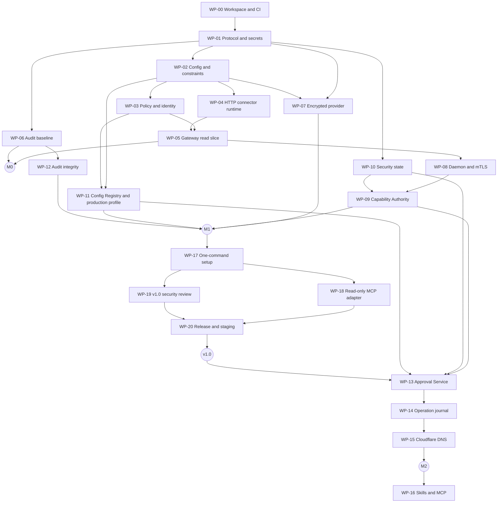

# Agent Credential Firewall — Implementation Plan

Status: M0 and M1 complete; v1.0 (read-only release) in progress

Last updated: 2026-10-27

## 1. Purpose

This document is the execution blueprint for Agent Credential Firewall (ACF). It turns the [system design](design.md) into work packages that can be assigned independently, each with explicit dependencies and acceptance criteria.

The production-shaped milestones must prove these properties end to end:

> An agent can perform an authorized semantic action without receiving the reusable credential used for that action.

> A trusted authority issues the task grant and binds it to the local daemon's identity. The agent cannot broaden it or carry it to another host.

> A mutation runs only after a human approves its exact, gateway-rendered content, and an ambiguous outcome is never retried automatically.

Each milestone builds only on contracts that earlier milestones have verified.

## 2. Milestones

```text
M0    Non-production semantic-action skeleton
 ↓
M1    Secure read path
 ↓
v1.0  Read-only release: M1 made installable and usable by agents
 ↓
M2    Approved mutation path
 ↓
M3    Extensions: Skills/MCP, Cedar, HA, more providers and connectors
```

v1.0 ships the M1 security core as a product before any mutation work. Real use will expose problems in the core that no amount of up-front design would. Fixing them on a small, deployed base is cheaper than reworking a large one.

### 2.1 M0 — non-production development skeleton

The operator runs:

```bash
acf-agent action execute \
  --action example.profile.get \
  --resource example-api:development
```

The request crosses the same semantic API shape intended for production:

```http
POST /v1/actions/execute
```

The expected response contains only allowlisted business data:

```json
{
  "user": "demo",
  "authenticated": true
}
```

The agent cannot select any of the following:

- An HTTP method, path, or absolute URL.
- A credential slot or authentication strategy.
- A secret reference.

M0 uses an explicitly marked development identity, the single in-memory provider, and the `development` deployment profile. It makes no production-security claim.

### 2.2 M1 — secure read path

M1 adds:

- A local daemon under a separate service identity, with a non-exportable device key and a peer-credential Unix socket.
- mTLS device identity.
- A Capability Authority issuing certificate-bound task capabilities, authorized by signed job definitions or by trusted scheduler policy.
- Request-ID replay protection, revocation, quotas, and rate limiting.
- Signed configuration bundles, secret use bindings, and `production` profile startup validation.
- A per-record encrypted local provider with an optional rollback anchor.
- Audit with external checkpoints or a remote append-only sink.

Human WebAuthn confirmation of task scope arrives in M2, together with the Approval Service.

### 2.3 v1.0 — read-only release

v1.0 adds no new security mechanism. It makes the M1 core deployable by one operator and usable by an agent:

- **One-command setup.** A single command generates a complete single-host production deployment: PKI, service and administrator keys, the configuration trust anchor, admitted configuration skeletons, device enrollment, and systemd units. Administrator signing keys and the CA key go to an offline directory, never to the servers.
- **Read-only MCP adapter.** A thin adapter over the daemon local API, so agents such as Claude Code call ACF as tools.
- **A bounded M1 security review**, scoped to the v1.0 trust boundaries, with every high-severity finding fixed before release.
- **Release packaging and a staging run** against one real read-only API.

**v1.0 is read-only.** Every `classification: mutate` action is refused, as it is today, until M2 delivers per-request human approval. Task authorization uses signed job definitions and trusted schedulers; human task confirmation also arrives with M2.

v1.0 ships with these documented limitations:

- The encrypted local store provides integrity only. There is no rollback anchor, so configuration must acknowledge `rollback_resistance: none`.
- Key sources are systemd credentials and protected mounted files. There is no TPM, KMS, or interactive unlock.
- One gateway per environment: no high availability or shared state.
- Revocation, device enrollment, and job definitions are file-based. There is no administrative API or UI.

**Compatibility promise.** From v1.0 on, the `acf.*/v1` configuration schemas, the capability and checkpoint wire formats (ADR 0003, ADR 0005), and the daemon local API change only in backward-compatible ways. An incompatible change needs a new schema version and a migration note.

### 2.4 M2 — approved mutation path

M2 adds:

- A WebAuthn-protected Approval Service on its own origin, also used for human task confirmation.
- Gateway-rendered approval objects, RFC 8785 digests, and one-time signed receipts.
- A durable operation journal, idempotency keys, and reconciliation after ambiguous downstream outcomes.
- Cloudflare DNS list and create through a declarative profile and DNS domain types.

### 2.5 M3 — extensions

M3 adds:

- Agent Skills and the MCP adapter.
- Cedar policy backend.
- High-availability gateways with shared, strongly consistent state.
- Additional secret providers and connectors.
- Posture and detection features.

## 3. Milestone acceptance criteria

### 3.1 M0

- `example.profile.get` works through `POST /v1/actions/execute`.
- Policy is deny by default and authorizes an exact semantic action/resource pair.
- Authorization happens before secret retrieval.
- The connector injects a canary credential into a fixed upstream request.
- `{params.*}` values cannot override `{resource.*}` bindings.
- The response contains only profile-allowlisted fields.
- Secret values do not appear in logs, audit events, errors, or protocol responses.
- Unknown actions, resources, parameters, destinations, and response fields are rejected.
- No public `http.request`, arbitrary method/path, absolute URL, or secret-value endpoint exists.

### 3.2 M1

- The Capability Authority is deployed as an explicit control-plane component with its own signing key.
- Task scope comes from a signed job definition or trusted scheduler policy. Agent input alone cannot authorize it.
- A capability is reusable within its TTL, bound to the daemon certificate, revocable, and constrained by action, resource, parameters, and quotas.
- Reusing a `requestId` is denied, but the capability itself is not single-use.
- The agent process receives only an opaque task handle and cannot read the daemon key in the documented production topology.
- The encrypted provider decrypts only the requested record and never loads an unrelated write credential for a read action.
- A secret is never released to a connector or origin outside its use binding.
- Production startup rejects development identity, insecure key sources, the in-memory provider, unsigned bundles, and an encrypted store that has neither a rollback anchor nor an explicit acknowledgement.
- Rate limits, revocation, and externally anchored audit are active.

### 3.3 M2

- `acf_request_approval` and gated `acf_execute_action` calls can create and poll an approval, but cannot approve one.
- The human sees the gateway-rendered normalized change and authenticates through WebAuthn on the Approval Service origin.
- An approval receipt is bound to one RFC 8785 canonical digest and is consumed once.
- Changing any parameter, the profile digest, the policy version, or a precondition invalidates the approval.
- Mutations are never retried automatically after an ambiguous timeout.
- Operation status exposes `prepared`, `awaiting_approval`, `approved`, `rejected`, `expired`, `sent`, `confirmed`, `failed`, or `unknown`, and never exposes credentials.
- Cloudflare DNS constraints are evaluated after DNS normalization.

### 3.4 M3

- Skills and MCP remain workflow-only and cannot bypass policy, approval, use bindings, or connector validation.
- Gateways deployed for high availability share replay, receipt, quota, revocation, and journal state with strong consistency.

## 4. Delivery strategy

Static typed YAML policy is sufficient through M2. Cedar is the preferred later policy engine, but adding a general-purpose policy language must not delay the core trust, storage, approval, and connector invariants.

Do not begin with a management UI, multi-tenancy, or a configuration database. Those features build on a verified data plane.

## 5. Cargo workspace

```text
crates/
├── acf-gateway/          # Data-plane request lifecycle
├── acf-control-plane/    # Capability Authority and Approval Service
├── acf-agent/            # Endpoint/VPS daemon and CLI
├── acf-protocol/         # API, task, approval, and operation models
├── acf-identity/         # Connection and local peer identity
├── acf-policy/           # Authorization and constraint composition
├── acf-config/           # Profile/resource/secret registration, validation, pinning
├── acf-state/            # Replay, revocation, quotas, receipts, operation journal
├── acf-secrets/          # Runtime/admin provider traits, protected types, in-memory provider
├── acf-provider-local/   # Encrypted local provider
├── acf-connectors/       # Semantic action connectors and domain types
└── acf-audit/            # Redacted, tamper-evident audit events

integrations/
├── mcp/
└── agent-plugin/
    ├── plugin.json
    ├── mcp.json
    └── skills/
        ├── acf-actions/
        ├── acf-cloudflare-dns/
        └── acf-connector-authoring/
```

Rules:

- Core crates do not depend on concrete secret providers or agent Skills.
- There is one in-memory provider, in `acf-secrets`, used by tests and the `development` profile. There is no separate mock provider.
- Protocol response types cannot contain `SecretMaterial`.
- Runtime secret retrieval exposes only exact-reference `get()`. Enumeration and mutation use the separate `SecretAdmin` trait.
- The gateway can verify capabilities and receipts, but it never holds the control-plane signing keys.
- Skills and MCP adapters depend on the action contract. Gateway authorization never depends on skill compliance.
- Runtime startup validation enforces production security. Compile-time features may remove test code, but they are not the sole security boundary.

## 6. Work packages

### M0 — non-production skeleton

#### WP-00 — Repository and CI foundation

Dependencies: none

Deliverables:

- Root Cargo workspace and crate skeleton.
- Pinned Rust toolchain, formatting, strict Clippy, unit and integration jobs.
- Dependency audit, license policy, and contributor commands.
- Ownership notes for security-sensitive crates.

Required CI commands:

```bash
cargo fmt --all -- --check
cargo clippy --workspace --all-targets --all-features -- -D warnings
cargo test --workspace --all-features
cargo audit
cargo deny check
```

Acceptance criteria:

- A clean checkout passes all CI jobs.
- Every crate compiles with a minimal public API.
- No network, cryptography, provider, or connector behavior is hidden in WP-00.

#### WP-01 — Protocol, protected secret types, and in-memory provider

Dependencies: WP-00

Deliverables:

- Stable IDs for requests, tasks, capabilities, approvals, operations, resources, actions, agents, and devices.
- `ActionRequest`, `ActionResponse`, `TaskCapability`, `ApprovalObject`, and operation-status models.
- `SecretRef`, `SecretVersion`, `SecretUseBinding`, `SecretMaterial`, `ResolvedSecret`, and redacted error types.
- Runtime `SecretProvider::get()` and administrative `SecretAdmin` traits.
- One in-memory provider for tests and development.
- Runtime provider conformance suite.

Required invariants:

- `SecretMaterial` does not implement `Display`, `Serialize`, `Clone`, or ordinary `Debug`.
- Response models cannot contain secret material.
- Secret-reference formatting is distinguishable from secret-value formatting.
- Capability `jti`, `requestId`, approval nonce, `idempotencyKey`, and `operationId` are distinct types.

Acceptance criteria:

- Compile-fail or equivalent tests prevent secret material from entering responses.
- Canary values are absent from formatted errors and debug output.
- The in-memory provider passes the runtime provider conformance suite.

#### WP-02 — Configuration schema, action contracts, and constraint language

Dependencies: WP-01

Deliverables:

- Versioned schemas for profiles, resources, secret registrations, providers, and deployment profiles.
- A fail-closed loader that rejects duplicates and unknown fields and validates cross-references.
- Explicit `{resource.x}` and `{params.x}` template namespaces with single-segment encoding rules.
- JSON Schema or equivalent structural parameter validation.
- The typed constraint language: `in`/`not_in`, `range`, `dns_within`/`allow_wildcard`, `glob`, `actions.deny`, and `quotas`.
- Secret use-binding validation for connector, origin, authentication slot, and environment.
- Default-deny response-field and header allowlists.
- Per-field audit classification: `record`, `hash`, or `omit`.

Acceptance criteria:

- Agent parameters cannot override resource bindings.
- A secret bound to one connector or origin cannot be configured for another.
- Constraint intersection never broadens either input.
- Missing response allowlists return no business payload and fail validation.

#### WP-03 — Static policy, identity model, and authorization composition

Dependencies: WP-01, WP-02

Deliverables:

- `IdentityContext`, `AuthorizationRequest`, and `PolicyEngine` traits.
- A development identity provider, isolated from production configuration.
- Deny-by-default typed YAML policy.
- Explicit composition across identity, task capability, gateway policy, resource constraints, and connector contract.
- Decision reason codes suitable for audit.

Composition rule:

```text
EffectivePermission =
  DeviceIdentity ∩ TaskCapability ∩ GatewayPolicy ∩ ResourceConstraints ∩ ConnectorContract
approval requirement = strictest applicable requirement
any deny, error, or missing required input = deny
```

Acceptance criteria:

- No allow decision overrides another layer's deny.
- All `classification: mutate` actions require approval by default, and policy cannot weaken that default.

#### WP-04 — Restricted semantic HTTP connector runtime

Dependencies: WP-01, WP-02

Deliverables:

- `ActionConnector` trait and restricted HTTP runtime.
- Bearer-token and API-key-header authentication strategies.
- Fixed origins, methods, and path templates; redirect policy; header filtering; payload bounds.
- DNS resolution that connects only to validated addresses, blocking loopback, link-local, and metadata destinations unless a development fixture allows them.
- Use-binding check on the final origin before credential injection.
- Default-deny response projection.
- Domain-type registry with `ipv4` and `ipv6`. The `dns_name` and `dns_record_content` types arrive in WP-15.

The connector rejects agent-supplied URLs, methods, paths, secret references, credential slots, authentication strategies, authorization headers, and redirects to another origin.

Acceptance criteria:

- The connector calls the local test upstream with an injected canary credential.
- The canary is absent from the connector response and logs.
- Negative tests cover host confusion, encoded traversal, `/` in path parameters, redirects, metadata destinations, DNS rebinding, and header injection.
- Profiles cannot override the runtime's mandatory redirect, address, or header controls.

#### WP-05 — Gateway semantic read vertical slice

Dependencies: WP-03, WP-04

Deliverables:

- `acf-gateway` with `GET /healthz` and `POST /v1/actions/execute`.
- `acf-agent` development CLI.
- `example.profile.get` profile and local upstream fixture.
- Request and response size limits, timeouts, and cancellation.
- In-memory provider integration.

Acceptance criteria:

- The M0 demo succeeds without exposing the canary credential.
- Authorization precedes retrieval, and retrieval precedes connector execution.
- Denied requests never invoke the provider.
- Cancellation does not leave credential-bearing background work running.

#### WP-06 — Audit baseline and canary leak harness

Dependencies: WP-01; integrates with WP-05

Deliverables:

- Versioned audit schema and redacted audit sink trait.
- Development JSON-lines sink.
- Canary leak-test harness that scans stdout, stderr, errors, metrics, audit output, and protocol responses.

Acceptance criteria:

- Allow and deny paths emit attributable events.
- Request fields appear only according to their audit classification.
- The canary secret is absent from every tested output surface.

### M1 — secure read path

#### WP-07 — Per-record encrypted local provider

Dependencies: WP-01, WP-02

Deliverables:

- Authenticated manifest plus independently encrypted record format.
- Per-record nonce and DEK handling through a reviewed AEAD implementation.
- `KeySource` abstraction for KEK unlock, plus production validation.
- Rollback-anchor interface and the manifest/anchor commit protocol.
- Atomic manifest updates, crash recovery, reload notification, and cache invalidation.
- Attested use bindings in authenticated record metadata.
- Root-controlled `SecretAdmin` commands, including forward-moving restore.

Acceptance criteria:

- `get()` decrypts only the selected record.
- A read-token lookup does not decrypt the paired write token.
- Wrong keys, modified records, altered bindings, and truncated files fail closed. With an anchor configured, old generations also fail closed.
- Anchor reconciliation behaves as specified for `G == A`, `G == A + 1`, `G < A`, and `G > A + 1`.
- Without an external anchor, documentation and status report that rollback resistance is unavailable.
- Restore never requires exporting all plaintext secrets.

Detailed requirements are in [Encrypted local provider](providers/encrypted-local.md).

#### WP-08 — Daemon isolation, peer identity, and mTLS

Dependencies: WP-05

Deliverables:

- Local daemon running under a separate service identity in the production topology.
- Permissioned Unix socket with `SO_PEERCRED` or an OS-equivalent caller context.
- Optional launcher-registered PID or cgroup scoping of task handles.
- Integration with a protected, non-exportable device key.
- rustls TLS 1.3 with mutual client authentication.
- Certificate-to-identity mapping and certificate rotation.
- Opaque task handles. Raw capabilities never cross the agent API.

Acceptance criteria:

- Untrusted, expired, or incorrectly scoped certificates fail authentication.
- The gateway does not trust agent-supplied identity headers.
- If TLS terminates at a proxy, the proxy-to-gateway hop is mutually authenticated and preserves the verified certificate identity.
- The agent account cannot read the daemon's mTLS private key in the documented production deployment.
- Documentation states that peer PID and UID prove OS provenance, not whether an instruction inside the authorized agent is benign.
- Mutations do not use TLS 0-RTT.

#### WP-09 — Capability Authority and task authorization

Dependencies: WP-08, WP-10

Deliverables:

- A Capability Authority API in `acf-control-plane`, with issuer-key separation from the gateway.
- Scope intersection: requested scope ∩ caller entitlements ∩ resource policy.
- Signed job-definition and trusted-scheduler authorization bases.
- Certificate-bound capability with `cnf.x5t#S256` semantics.
- Validation of `iss`, `aud`, `iat`, `nbf`, `exp`, action, resource, environment, parameters, and quotas.
- Daemon-side capability storage and task-handle mapping.
- An ADR fixing the capability wire encoding.

Acceptance criteria:

- Agent-requested scope is only a proposal and cannot authorize itself.
- The same valid capability authorizes multiple permitted requests within its TTL.
- A capability presented over a different client certificate is denied.
- The gateway can verify capabilities but cannot mint them.

#### WP-10 — Security state: replay, revocation, quotas, and rate limiting

Dependencies: WP-01

Deliverables:

- A `StateStore` interface in `acf-state`, designed for a later shared, strongly consistent backend.
- An embedded durable single-node implementation.
- A `requestId` replay cache with timestamp freshness and restart rules.
- Capability and session revocation with a revocation feed.
- Per-task, per-principal, per-resource, and per-action quotas and rate limits.

Acceptance criteria:

- Reusing a `requestId` is denied.
- After a restart without a durable replay cache, requests timestamped at or before start time plus the allowed clock skew are rejected.
- Revocation and quota updates take effect within a documented, bounded latency.

#### WP-11 — Config Registry and production profile

Dependencies: WP-02, WP-03

Deliverables:

- Signed or hash-pinned configuration bundles. Profile authoring and secret-binding administration are separate signing permissions.
- An admission flow in which agent-authored profiles remain inert drafts.
- `production` startup validation as defined in design §13.4.
- Build-flavor and deployment-profile reporting.

Acceptance criteria:

- An unsigned or unpinned bundle fails production startup.
- A binary built with the development feature refuses the `production` profile.
- Production configuration cannot enable development identity, insecure key sources, the in-memory provider, or plaintext listeners.

#### WP-12 — Audit integrity

Dependencies: WP-06

Deliverables:

- Hash-linked audit events.
- Signed checkpoints to an external append-only sink, or direct writes to a remote append-only sink.
- Explicit policy for audit-sink failure.

Acceptance criteria:

- Truncation or replacement after the most recent external checkpoint is detectable.
- A local hash chain alone is never described as sufficient against host compromise.
- When audit is required and the sink fails, behavior follows the explicit fail-closed policy.

### v1.0 — read-only release

#### WP-17 — One-command setup

Dependencies: M1

Deliverables:

- An `acf-setup init` command that writes one directory per role:
  - **`gateway/`**: server certificate and key, checkpoint client certificate, audit key, store key, config bundle, profiles and policy with their signatures, trust anchor, device registry, authority and audit key sets, and a systemd unit.
  - **`control-plane/`**: server certificate and key, signing key, authority configuration, device registry, audit key set, and a systemd unit.
  - **`agent-<device>/`**: client certificate and key, gateway CA, and a systemd unit for the daemon.
  - **`offline/`**: CA key and administrator signing keys. These never belong on a server.
- An `acf-setup admit` command that validates the edited gateway configuration and re-signs every document with the right role key.
- Units that run each service under its own account with systemd hardening.
- The control plane loads separately admitted profiles (`--profiles`), as the gateway does.
- A deployment guide covering single-host and split installs, adding a connector, loading a secret, defining a job, and rotating certificates.

Acceptance criteria:

- From a fresh `acf-setup init`, the gateway, control plane, and daemon start under `production` using exactly the generated unit commands, and the daemon reaches the authority over mTLS.
- No generated server directory contains the CA key or an administrator signing key.
- Every generated private key has mode 0600 or stricter.

#### WP-18 — Read-only MCP adapter

Dependencies: WP-17

Deliverables:

- An MCP server over the daemon local API exposing `acf_request_task`, `acf_get_task_status`, and `acf_execute_action`. Discovery tools follow if the daemon gains a describe endpoint.
- Tool schemas versioned with the local API, plus a client configuration example for Claude Code.

Acceptance criteria:

- No tool response contains a capability, a credential, or a secret reference value that the local API would not return.
- A tool call with a mutation action returns the gateway's refusal unchanged.

#### WP-19 — v1.0 security review

Dependencies: WP-17

Deliverables:

- A written review of the v1.0 trust boundaries: agent ↔ daemon, daemon ↔ authority, daemon ↔ gateway, administrator ↔ configuration, gateway ↔ store, and gateway ↔ collector.
- Fixes for every high-severity finding. Remaining findings are recorded with their severity and owner.

#### WP-20 — Release packaging and staging validation

Dependencies: WP-17, WP-18, WP-19

Deliverables:

- Versioned release binaries built from a tagged commit, with checksums.
- A staging deployment from `acf-setup` serving one real read-only API end to end. The run checks the audit log against its checkpoints.
- Release notes listing the v1.0 limitations above.

### M2 — approved mutation path

#### WP-13 — Approval Service and WebAuthn

Dependencies: WP-09, WP-10, WP-11

Deliverables:

- An Approval Service on its own origin behind an identity-aware entry point.
- WebAuthn registration and user-verified assertions.
- Rendering of the gateway-built approval object.
- Approver authorization by policy, and optional confirmation from a second device for production resources.
- Signed one-time receipts bound to digest, approver, expiry, and nonce.
- An internal authenticated channel for creating pending approvals and fetching receipts.
- Human task-scope confirmation for the Capability Authority, reusing the same WebAuthn flow.

Acceptance criteria:

- Agent-facing APIs cannot complete an approval.
- The requesting workload identity cannot act as approver.
- Gateway-rendered content, not agent-authored prose, is the approval's source of truth.
- Receipts never pass through the agent or daemon.

#### WP-14 — Operation journal and mutation execution

Dependencies: WP-05, WP-10, WP-13

Deliverables:

- RFC 8785 canonical approval objects and SHA-256 digests.
- `idempotencyKey` handling: the same digest returns the existing operation, and a different digest is rejected.
- Durable operation states, as defined in design §9.2.
- Precondition evaluation at preparation time and again at execution time.
- Atomic receipt consumption.
- A durable `sent` journal entry before the downstream call, with no automatic retry.
- Reconciliation through connector-defined queries or an operator decision.
- `GET /v1/operations/{operation_id}`.

Acceptance criteria:

- Changing any field that the digest covers invalidates the receipt.
- Reusing an approval receipt is denied.
- An ambiguous downstream timeout produces `unknown`, never a retry.
- A precondition that changed after approval causes rejection and requires a new approval.

#### WP-15 — Cloudflare DNS

Dependencies: WP-04 and M1 for list; WP-14 for create

Deliverables:

- `dns_name` and `dns_record_content` domain types covering lowercase, trailing dot, IDNA A-labels, relative-name rejection, wildcard parsing, and record-type-dependent content.
- Cloudflare DNS list and create profiles, resource registration, and secret registrations.
- A conflict-detection precondition for create.

Acceptance criteria:

- Cloudflare zone IDs can come only from `{resource.zone_id}`.
- Constraint matching operates on normalized DNS values.
- Cloudflare create requires a valid one-time approval receipt.
- A read action never retrieves the write token.
- Response fields absent from the profile allowlist do not cross the gateway.

### M3 — extensions

#### WP-16 — Agent Skills and MCP integration

Dependencies: stable WP-09 task flow, WP-13 and WP-14 approval and operation flows, and WP-15 action contracts

This package is a workflow layer, not an authorization boundary.

Deliverables:

- A thin MCP adapter over the daemon local API, covering:
  - `acf_list_resources`, `acf_describe_resource`, and `acf_describe_action`.
  - `acf_request_task` and `acf_get_task_status`.
  - `acf_execute_action` and `acf_request_approval`.
  - `acf_get_request_status` and `acf_verify_action_result`.
- `acf-actions`, `acf-cloudflare-dns`, and `acf-connector-authoring` Skills.
- Versioned tool schemas and evaluations covering malicious instructions.

Required invariants:

- Skills contain no token, provider credential, private key, storage key, raw capability, or production secret.
- `acf_request_approval` creates or polls an approval. It never approves one.
- Agent-authored connector profiles cannot activate themselves.
- Skipping or modifying a Skill cannot bypass policy, approval, use bindings, connector validation, or response filtering.

Acceptance criteria:

- A supported agent can inspect, propose a task, request approval, execute, reconcile, and verify using the documented flow.
- A request for the underlying token never produces a secret-bearing tool response.
- A modified Skill that skips approval receives `approval_required` or a denial.

#### M3 workstreams

These are planned after M2 and are detailed when M2 contracts are stable:

- Cedar policy backend with schema validation and policy analysis. Domain normalization remains in connectors.
- A shared, strongly consistent `StateStore` backend and high-availability gateways per environment and region.
- Additional secret providers, starting with the [Bitwarden adapter](providers/bitwarden.md).
- Additional connectors, such as a GitHub App connector with installation-token exchange.
- Posture-aware policy, anomaly detection, SIEM integration, and credential inventory.

## 7. Dependency and merge order



Recommended order:

1. WP-00, then WP-01.
2. WP-02, WP-06, and the WP-10 interfaces in parallel.
3. WP-03 and WP-04 in parallel, then WP-05 to complete M0.
4. WP-07, WP-08, WP-10, WP-11, and WP-12 in parallel, then WP-09 to complete M1. (Done.)
5. WP-17, then WP-18 and WP-19 in parallel, then WP-20 to release v1.0. WP-19 is the security review of M1 that precedes any mutation work.
6. WP-13, then WP-14, then WP-15 to complete M2, prioritized by what v1.0 users need.
7. WP-16 and the other M3 workstreams. WP-18 already covers the read-only part of WP-16.

## 8. Parallel agent allocation

| Lane | Primary work | Avoid editing |
| --- | --- | --- |
| Core | WP-01 protocol and types | Provider and binary internals |
| Config/policy | WP-02, WP-03, WP-11 | Cryptographic storage internals |
| Connector | WP-04, WP-15 | Capability issuance |
| Gateway/identity | WP-05, WP-08 | Provider internals |
| Provider | WP-07 | Public protocol without coordination |
| Authority/state | WP-09, WP-10 | Connector profiles |
| Approval/journal | WP-13, WP-14 | Agent Skills |
| Audit | WP-06, WP-12 | Feature behavior without coordination |
| Agent integration | WP-16 | Gateway authorization behavior |

One owner controls each crate during its initial creation. Interface changes require notifying dependent lanes. Integration commits must not disable security tests to resolve conflicts.

## 9. Pull request contract

Every implementation PR contains:

- Work-package identifier.
- Scope and explicit non-goals.
- Security invariants affected.
- Test evidence, including negative paths.
- New dependencies and their purpose.
- Any plaintext or trusted-state boundary introduced.
- Migration and compatibility impact on profiles, capabilities, or stored data.
- Known limitations and follow-up work.

## 10. Definition of done

A work package is done when:

- Acceptance criteria are covered by automated tests where practical.
- Formatting, Clippy, tests, dependency audit, and license policy pass.
- Errors are typed and redacted.
- Network behavior has timeouts and bounded payloads.
- Configuration changes fail closed and have migration tests when required.
- Threat-model implications are documented.
- No production behavior relies on development identity, test credentials, or test key sources.

## 11. Security test matrix

| Scenario | Expected result |
| --- | --- |
| Known identity, permitted task/action/resource | Allow |
| Agent proposes scope without trusted authorization | Deny issuance |
| Capability presented with wrong client certificate | Deny |
| Expired or revoked capability | Deny |
| Second allowed request using the same valid capability | Allow |
| Reused `requestId` | Deny as replay |
| Request timestamp outside freshness window | Deny |
| Capability parameter or quota exceeded | Deny |
| Unknown action or resource | Deny before retrieval |
| Agent-supplied method, path, URL, credential slot, or auth header | Reject |
| Resource-binding shadowing attempt through `params` | Reject |
| Secret use-binding origin/connector mismatch | Deny before injection |
| Provider-attested binding broader than registry binding | Deny |
| Missing response-field allowlist | Return no unapproved fields; fail validation |
| Agent attempts to approve its own request | Deny |
| Requesting workload identity acts as approver | Deny |
| Modified canonical approval object or changed profile/policy version | Deny |
| Reused approval receipt | Deny |
| Same `idempotencyKey` with a different digest | Reject |
| Precondition changed after approval | Reject; require new approval |
| Ambiguous mutation timeout | Mark `unknown`; do not retry automatically |
| Old encrypted generation with rollback anchor | Deny |
| Old encrypted generation without anchor | Report unsupported rollback guarantee |
| Audit chain truncated past external checkpoint | Detect |
| Canary secret in error path | Canary absent from all outputs |
| Production config enables development identity, key source, or in-memory provider | Startup failure |
| Development-feature build started with `production` profile | Startup failure |

## 12. Deliberately out of scope

- Web management console beyond the Approval Service.
- Multi-tenant control plane.
- Production configuration database.
- Kubernetes operator.
- Downstream-native short-lived credential brokering such as STS.
- General-purpose command execution.
- Static token injection or Local Lease Mode.
- Arbitrary secret retrieval and unrestricted HTTP proxy endpoints.
- A broad connector catalog.

Out-of-scope work must not be pulled into an early work package unless it blocks a milestone's demonstrable outcome.

## 13. Immediate next actions

1. WP-17: one-command setup, including control-plane `--profiles` support.
2. WP-18 and WP-19 in parallel once WP-17 lands.
3. WP-20: tag v1.0 after a staging run against a real read-only API.

Deferred until after v1.0, and reprioritized by real use:

- The Approval Service, WebAuthn, and human task confirmation (M2).
- The KEK with per-record DEKs, the rollback anchor, storage-key rotation, and TPM, KMS, and interactive key sources.
- High availability and shared state, the Cedar policy backend, and administrative APIs and UI.
- Audit log rotation tooling, external secret providers, and Skills.

Milestone gates:

- **v1.0:** WP-17 through WP-20. Read-only; mutations stay refused.
- **Mutation work:** must not begin until WP-19 is complete and the WP-13 approval contract has been reviewed.
